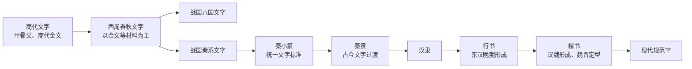
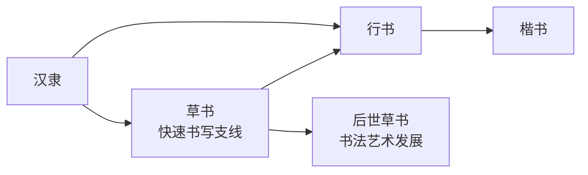

# 汉字演化分期与展示规范

> 文档状态：后续数据接入、内容生成和界面展示的规范性依据  
> 制定日期：2026-08-08

## 1. 核心参考文献

陈双新、李娜：《古今汉字的演变》，中华人民共和国教育部，2013-08-27。  
原文：[教育部政府门户网站](https://www.moe.gov.cn/jyb_xwfb/xw_fbh/moe_2069/s7135/s7562/s7569/201308/t20130827_156347.html)

辅助核对版本：

- [《古今汉字的演变（上）》](https://www.sinoss.net/c/2013-09-10/534713.shtml)，中国高校人文社会科学信息网，来源标注为《中国教育报》；
- [《古今汉字的演变（下）》](https://www.sinoss.net/c/2013-09-16/534721.shtml)，中国高校人文社会科学信息网，来源标注为《中国教育报》。

本文档只摘取分期结论并进行工程化转述，不复制原文全文。

## 2. 文章确定的分期原则

### 2.1 古文字与今文字

以秦国篆隶变化为分水岭，将汉字形体史划分为：

- 古文字阶段：商代文字、西周春秋文字、六国文字和秦系文字；
- 今文字阶段：以隶书、楷书为主体，从汉代延续至现代。

因此，项目不能把“甲骨文、金文、战国文字、篆书、隶书、楷书、草书”理解为七个严格首尾相接、前者消失后才出现后者的年代盒子。

### 2.2 古文字内部

- 大规模成系统的甲骨文材料主要见于商代晚期；
- 金文跨越商周，西周及春秋金文持续变化，并形成地域书写特色；
- 战国时期存在显著地域异形，至少应区分六国文字与秦系文字；
- 秦统一后以小篆作为统一文字标准；
- 实际书写中的方折化和结构改造形成秦隶，成为古文字向今文字过渡的重要节点。

### 2.3 今文字内部及支线

- 秦隶进一步发展为汉隶，隶书是两汉主要通行字体；
- 草书在汉代主要承担起草文件、通信等快速书写功能，与隶书并行；
- 东汉晚期，行书在隶书和草书基础上形成；
- 汉魏之际，楷书在行书基础上产生，经过魏晋时期逐步取得主导地位；
- 唐以后草书更突出艺术欣赏属性，不应作为楷书之后的下一代规范字体。

### 2.4 演变规律

文章将主要规律概括为：

1. 简化：受书写工具、载体和使用效率影响，图形、部件和笔画不断调整；
2. 声化：形声构造的比例和能产性逐渐提高；
3. 规范化：历代政府和学者持续整理异体、统一字形。

项目生成“变化说明”时，应优先从这三类规律组织表述，同时仍需绑定具体汉字的证据，不能把一般规律直接当作单字事实。

## 3. 字脉采用的演化结构

### 3.1 历史主干

六国文字并非全部直接汇入秦小篆。界面应表现战国文字的地域分支，以及秦统一后以秦系文字为基础进行规范化的关系。

### 3.2 书写支线

草书应显示为支线或并行书体，不能放在“楷书之后”并用单向箭头暗示楷书演变成草书。

## 4. 数据与界面规则

每个字形样本必须分别记录“历史分期”和“书体/材料类型”，二者不得混用：

| 字段 | 含义 | 示例 |
|---|---|---|
| `historical_period` | 历史分期 | 战国时期 |
| `script_type` | 书体或资料分类 | 战国文字、篆书 |
| `lineage_role` | 主干、分支或过渡 | `mainline`、`branch`、`transition` |
| `region_or_system` | 地域或文字系统 | 秦系、楚系、六国未详 |
| `sample_date` | 该图片本身的可靠年代 | 战国中期；数据集未提供则为空 |
| `source_path` | 数据集原始路径或馆藏编号 | `JieZi-Dataset/images/...` |
| `availability` | 样本状态 | `available`、`dataset_gap` |

界面遵循以下规则：

- 主时间线展示历史主干，草书使用分支卡片；
- “篆书”样本只有在来源明确时才标为“小篆”；
- 金文样本没有可靠断代时，不自动标成西周；
- 战国文字没有地域依据时标为“地域未详”，不猜测秦系或楚系；
- 图片没有器物、简牍或碑刻断代时，显示“来源未提供该图精确年代”；
- 缺少某阶段时保留资料缺口，不拿其他汉字、现代字体或生成图片补齐；
- 现代简化字或规范字是现代字形规范，不作为古代书体处理。

## 5. JieZi 数据集映射规则

JieZi 的七类目录是数据集分类，不等同于七段严格年代链：

| JieZi 分类 | 项目解释 |
|---|---|
| 甲骨文 | 商代文字中的甲骨材料样本；精确年代以单图来源为准 |
| 金文 | 商周金文样本；不得统一写成西周 |
| 战国文字 | 战国字形样本；地域系统未知时必须明示 |
| 篆书 | 篆书样本；只有证据充分时细分为秦小篆 |
| 隶书 | 隶书样本；只有证据充分时细分秦隶或汉隶 |
| 楷书 | 楷书样本，放在历史主干 |
| 草书 | 并行书写/书法支线，不放在楷书之后作为主干终点 |

当前演示字若在 JieZi 中缺少某一分类，系统使用 `dataset_gap` 记录。数据集缺口不计为可用字形阶段，但可以作为界面中的可解释断层展示。

## 6. 后续开发验收规则

- 时间线不得把草书放在楷书之后作为线性终点；
- 战国文字节点能够表达秦系、六国系或地域未详；
- 小篆、秦隶、汉隶只有在来源支持时使用精确名称；
- 每张图片同时显示数据集路径、授权信息和样本年代边界；
- 所有演化总结至少对应“简化、声化、规范化”之一，或明确标为其他可证变化；
- 缺少图片时显示真实缺口，验收不得以生成占位字形通过。
