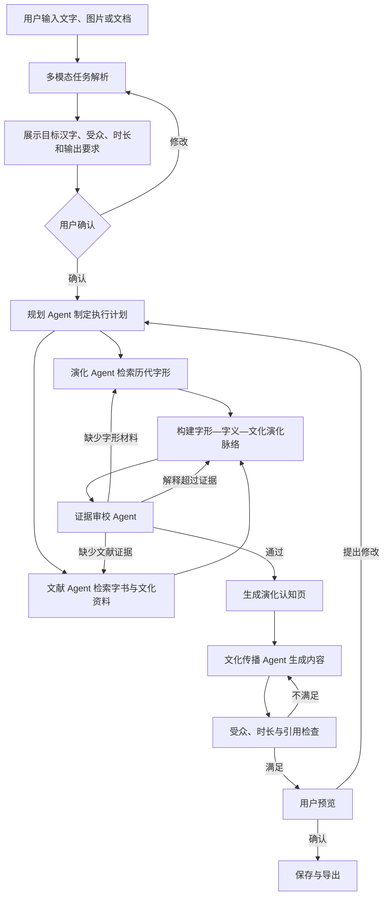

# 字脉产品需求文档（PRD）

> 项目名称：字脉——面向汉字演化认知与文化传播的多模态智能体  
> 文档版本：v1.0  
> 文档状态：比赛版范围已确认  
> 目标提交日期：2026-09-01  
> 适用范围：产品、设计、前端、后端、智能体、数据与评测开发

---

## 1. 文档目的

本文档用于统一“字脉”比赛版的产品目标、用户流程、功能边界、交付效果和验收标准，并作为后续交互设计、技术方案、任务拆解和测试工作的依据。

后续开发应优先保证本文档定义的 P0 闭环完整可用。未经评审，不新增与主闭环无关的功能。

---

## 2. 产品概述

### 2.1 产品定位

“字脉”是一款面向汉字文化内容创作者的 Web 多模态智能体系统。

用户可以通过文字、图片或文档描述汉字文化任务。系统理解目标汉字、受众、时长和输出要求，自主检索历代字形与相关文献，构建“字形—字义—文化语义”演化脉络，审校事实与争议，最终生成面向特定受众的可视化文化讲解内容。

### 2.2 一句话定义

> 用户提出汉字文化传播任务，“字脉”自主完成任务理解、资料检索、演化组织、证据审校和受众化表达，交付一份可追溯的汉字演化认知页和文化传播作品。

### 2.3 核心价值

当前汉字字源、历代字形、字书释文、学术观点和文化资料分散在不同载体中。普通用户需要手工查找、判断、整理和改写；通用大语言模型又容易混淆年代、遗漏争议或生成无依据的字源解释。

“字脉”解决的不是“查到一个汉字”，而是：

1. 将分散资料组织为清晰的演化脉络；
2. 将事实、主流观点、争议观点与系统归纳分开表达；
3. 将同一份演化知识转化为适合不同受众的文化内容；
4. 通过多智能体执行与审校闭环，减少人工整理成本。

---

## 3. 产品目标与非目标

### 3.1 比赛版目标

比赛版必须实现以下完整闭环：

```text
文字/图片/文档输入
→ 任务解析与用户确认
→ 智能体制定执行计划
→ 历代字形和文献检索
→ 字形—字义—文化语义演化构建
→ 证据与年代审校
→ 可视化汉字演化认知页
→ 面向指定受众生成文化传播内容
→ 约束检查和自动修正
→ 用户预览、调整与导出
```

比赛版最终交付三个产品能力：

1. 多模态汉字文化任务入口；
2. 可交互、可追溯的汉字演化认知页；
3. 基于演化证据生成的文化传播作品。

### 3.2 明确不做

比赛版不包含：

- 未知古文字图像识别；
- 甲骨文自动释读或“破解”；
- 整片拓片 OCR 与全文翻译；
- 根据一张残损古文字图片直接判断现代汉字；
- 自训练通用或垂直大语言模型；
- VR、AR、数字人；
- 文创商品与图片 AIGC；
- 完整视频自动生成；
- 覆盖全部汉字；
- 代替文字学专家给出学术定论。

### 3.3 多模态边界

“多模态”表示系统能够理解用户通过文字、图片和文档提供的任务上下文，而不是古文字视觉识别。

图片可用于读取：

- 教材或课程页面；
- 博物馆展品及展签；
- 汉字文化海报；
- 已知汉字的演化资料截图；
- 用户已有的讲解内容。

如果图片中只包含无法确认的古文字字形，系统必须要求用户补充目标现代汉字或相关说明，不得自行给出确定释读。

---

## 4. 目标用户

### 4.1 主要用户

#### 用户 A：中小学教师

目标：快速制作适合特定年级和课时的汉字文化讲解。

痛点：资料查找耗时、专业资料难理解、现成内容难以适配学生年龄。

#### 用户 B：博物馆社教与讲解人员

目标：根据展品和展签补充汉字演化脉络，生成成人版或儿童版讲解。

痛点：字形、器物、年代和文化解释分散，内容需要反复核实。

#### 用户 C：汉字文化内容创作者

目标：生成有演化依据的文化卡片、文章提纲或短视频脚本。

痛点：通用大模型容易生成通俗但不准确的字源故事。

### 4.2 次要用户

- 国际中文教育教师；
- 汉字文化爱好者；
- 学生和普通参观者。

比赛演示默认使用“教师/文化内容创作者”身份。

---

## 5. 核心使用场景

### 5.1 场景一：从现代汉字生成演化认知内容

用户输入：

> “鼎”字的字形和文化含义经历了什么变化？

系统输出：

- 历代代表字形时间线；
- 每个阶段的年代、来源和构形说明；
- 字形变化、字义变化和文化语义变化；
- 主流观点、其他观点和证据等级；
- 可展开的证据卡片。

### 5.2 场景二：根据图片或文档创建文化传播任务

用户上传博物馆展签照片并输入：

> 根据这张展签，为小学六年级学生制作一份 4 分钟的“鼎”字文化讲解，至少展示三个历史阶段，存在争议的解释不要写成定论，并生成两道互动题。

系统需要：

1. 从图片中提取展品、年代和目标汉字等上下文；
2. 结构化任务要求并让用户确认；
3. 制定执行计划；
4. 完成检索、演化构建和证据审校；
5. 生成互动讲解内容；
6. 检查受众、时长、历史阶段和互动题数量；
7. 不满足要求时自动修改。

### 5.3 场景三：修改现有结果

用户在结果页补充：

> 把内容压缩为 2 分钟，并改成面向国际中文学习者的中英双语文化卡。

系统必须复用已经审校通过的演化知识，只重新规划表达层，不得改变已有事实或重新生成相互矛盾的字源结论。

---

## 6. 产品信息架构

```text
任务创建页
├── 自然语言任务输入
├── 图片上传
├── PDF/DOCX 上传
└── 示例任务

智能体工作台
├── 任务理解与确认
├── 执行计划与状态
├── 汉字演化认知
├── 证据与争议
└── 异常、回退和修正记录

文化传播页
├── 受众和时长设置
├── 内容形式设置
├── 传播内容编辑
├── 互动预览
├── 约束检查
└── 保存与导出
```

---

## 7. 核心用户流程



---

## 8. 功能需求

### 8.1 FR-001：自然语言任务输入（P0）

用户可输入：

- 单个汉字；
- 多个汉字；
- 成语、诗文或文化主题；
- 关于字形、字义或文化变化的问题；
- 包含受众、时长和输出形式的复杂任务。

系统应提取：

- 目标汉字；
- 文化主题；
- 用户角色；
- 目标受众；
- 预计时长；
- 输出形式；
- 必须包含的内容；
- 禁止或需要谨慎处理的内容。

验收条件：系统在执行前展示结构化结果并允许用户修改。

### 8.2 FR-002：图片上下文输入（P0）

支持 JPG、PNG、WEBP。

系统使用 OCR/VLM 提取：

- 图片中的现代汉字和文字说明；
- 文物或展品名称；
- 图片中明确给出的年代；
- 用户可能关注的文化主题。

如果无法确认目标汉字，必须询问用户，不自动进行古文字释读。

### 8.3 FR-003：文档上下文输入（P0）

支持 PDF、DOCX、TXT、Markdown。

系统提取：

- 已有讲解内容；
- 课程或传播要求；
- 目标受众；
- 篇幅和时长要求；
- 用户已提供的引用和来源。

系统需要区分“用户提供的材料”与“系统检索的新材料”。

### 8.4 FR-004：任务确认（P0）

执行前必须展示：

```text
目标汉字
目标受众
预计时长
输出类型
历史阶段要求
引用要求
互动要求
其他限制
```

用户可直接修改任一字段。

### 8.5 FR-005：执行计划生成（P0）

规划 Agent 根据任务生成可执行步骤，并记录每一步的：

- 目标；
- 执行 Agent；
- 所需工具；
- 输入依赖；
- 完成状态；
- 失败后的下一动作。

用户界面只展示计划、行动和结果摘要，不展示模型内部思维过程。

### 8.6 FR-006：历代字形检索（P0）

系统根据目标汉字获取可用历史字形，包括但不限于：

- 商代文字中的甲骨文与金文材料；
- 西周、春秋金文等材料；
- 战国六国文字与秦系文字；
- 秦小篆；
- 秦隶与汉隶；
- 行书与楷书；
- 作为书写支线的草书；
- 现代规范字，以及适用时的简化字、繁体字关系。

上述项目不是必须首尾相接的单线书体序列。系统以秦篆、秦隶为古文字与今文字的分水岭，主时间线和书写支线遵循 [汉字演化分期与展示规范](./EVOLUTION_FRAMEWORK.md)。

每个字形记录至少包含：

- 字形图片；
- 历史阶段；
- 大致年代；
- 来源名称；
- 来源编号或链接；
- 是否为异体；
- 使用许可或引用方式。

历史分期、书体/资料类型、主干或支线角色、地域文字系统和单图可靠年代必须分开记录。

系统不得为了补齐时间线而生成不存在的历史字形。

### 8.7 FR-007：代表字形选择（P0）

同一时期存在多个异体时，系统需要选择适合当前任务的代表字形，并保留查看其他异体的入口。

选择依据包括：

- 来源明确；
- 图像完整；
- 具有代表性；
- 能与前后阶段比较；
- 适合目标受众理解。

系统应允许：

- 一对多；
- 多对一；
- 异体并存；
- 演化断层；
- 不同学术观点。

不得将复杂演化强行表达为唯一线性路径。

### 8.8 FR-008：文献混合检索（P0）

系统综合使用：

- 关键词检索；
- 向量语义检索；
- 演化知识图谱检索；
- 来源和编号精确检索。

检索结果必须保留：

- 来源；
- 标题；
- 作者或机构；
- 发表时间；
- 原文片段；
- 链接或书目；
- 支持的结论；
- 来源类型和权威等级。

### 8.9 FR-009：三层演化构建（P0）

系统生成三层关联结构。

#### 字形演化层

描述历史字形和构件如何变化。

#### 字义演化层

区分本义、引申义、假借义和现代常用义。

#### 文化语义层

描述字义与生活方式、社会制度或文化观念的关系。

文化语义必须有来源支持。系统归纳应明确标注为“系统归纳”，不能伪装为文献事实。

### 8.10 FR-010：演化认知页（P0）

演化认知页应包含：

1. 汉字基本信息；
2. 可交互历史时间线；
3. 各阶段代表字形；
4. 阶段之间的主要变化；
5. 字义演化；
6. 文化语义演化；
7. 观点与争议；
8. 证据来源；
9. 审校状态。

交互要求：

- 点击阶段查看详情；
- 前后字形并排或叠加比较；
- 查看其他异体；
- 点击陈述打开证据卡片；
- 切换“字形/字义/文化”三个视图。

### 8.11 FR-011：陈述级证据绑定（P0）

所有事实性陈述都应记录：

- `claim_id`；
- 陈述内容；
- 陈述类型；
- 支持证据 ID；
- 证据等级；
- 是否存在冲突；
- 审校状态。

陈述类型包括：

```text
文献事实
主流释读
其他观点
系统归纳
通俗说法
```

### 8.12 FR-012：证据审校与回退（P0）

审校 Agent 检查：

- 是否存在来源；
- 来源是否支持对应结论；
- 是否混淆历史时期；
- 是否混淆本义、引申义和现代义；
- 是否将推测写成事实；
- 是否存在民间拆字或望文生义；
- 是否遗漏重要争议观点；
- 是否引用失效或无权使用的素材。

审校结果：

```text
通过
需补充证据
需降低表述强度
需并列展示争议
不允许使用
```

系统根据审校结果自动路由：

- 缺少来源 → 文献检索 Agent；
- 缺少阶段材料 → 演化 Agent；
- 表述过度 → 文化传播 Agent 或演化总结节点；
- 多次失败 → 请求用户确认或明确表示资料不足。

### 8.13 FR-013：证据等级（P0）

系统使用统一的证据等级：

- A：多个早期字形或权威资料共同支持；
- B：主流观点，有可靠材料，但仍存在讨论；
- C：推测性解释或材料有限；
- D：通俗说法、民间解释或证据不足。

等级用于帮助用户理解不确定性，不作为自动替代专家判断的结论。

### 8.14 FR-014：文化传播内容生成（P0）

系统根据已经审校通过的演化知识包生成文化传播内容。

比赛版主要交付形式：

> 可视化互动文化讲解页。

页面包括：

- 标题；
- 开场问题；
- 演化时间线；
- 分阶段讲解；
- 字义和文化变化；
- 互动题；
- 总结；
- 资料来源。

辅助文本形式：

- 课堂讲解稿；
- 博物馆导览词；
- 30 秒或 60 秒短视频脚本；
- 中英双语文化卡（P1）。

### 8.15 FR-015：受众与时长适配（P0）

用户可设置：

- 小学生；
- 初中生；
- 成人；
- 国际中文学习者（P1）。

系统根据受众调整：

- 词汇难度；
- 句子长度；
- 背景知识量；
- 举例方式；
- 互动题难度；
- 中英文表达。

系统根据目标时长估算字数和讲解结构。事实层在切换受众或时长后必须保持一致。

### 8.16 FR-016：约束检查与自动修正（P0）

生成后检查：

- 是否包含指定历史阶段；
- 是否满足目标时长；
- 是否适合目标受众；
- 是否满足互动题数量；
- 是否所有事实陈述已绑定证据；
- 是否仍包含审校不通过的内容。

不满足时自动修正，最多自动迭代两次。两次后仍失败，向用户说明未满足的约束。

### 8.17 FR-017：用户编辑与局部再生成（P0）

用户可：

- 调整目标受众和时长；
- 增删历史阶段；
- 更换代表字形；
- 修改讲解文字；
- 接受、降低强度或删除争议陈述；
- 只重新生成某个段落或传播版本。

局部修改不应触发整个研究流程无条件重跑。

### 8.18 FR-018：执行记录（P0）

展示：

- 当前执行步骤；
- 调用的 Agent 和工具；
- 检索到的资料数量；
- 审校发现的问题；
- 回退与修正行为；
- 当前任务是否完成。

不展示模型私有推理过程。

### 8.19 FR-019：保存与导出（P0）

支持：

- 保存任务；
- 恢复任务状态；
- 复制 Markdown；
- 导出 HTML；
- 浏览器打印为 PDF；
- 导出结构化 JSON 供后续应用使用。

---

## 9. 多智能体产品职责

产品内部采用五类 Agent，但用户看到的是统一的“字脉”智能体。

### 9.1 规划与意图理解 Agent

职责：

- 解析多模态输入；
- 识别目标汉字和任务约束；
- 生成执行计划；
- 调度其他 Agent；
- 根据失败和用户反馈重新规划。

退出条件：任务信息完整并形成可执行计划。

### 9.2 演化分析 Agent

职责：

- 获取历代字形；
- 选择代表字形；
- 构建字形与字义演化结构；
- 标记断层、异体和冲突。

退出条件：生成结构化演化草案，并对每个节点附带来源。

### 9.3 文献检索 Agent

职责：

- 执行关键词、向量和图谱检索；
- 获取支持或反对不同解释的证据；
- 返回结构化证据对象。

退出条件：核心陈述拥有足够证据，或明确标记资料不足。

### 9.4 证据审校 Agent

职责：

- 执行来源核验；
- 检查年代一致性；
- 检查事实与推断边界；
- 识别争议和通俗误读；
- 决定通过、退回或降级表述。

退出条件：所有待发布事实性陈述均处于允许状态。

### 9.5 文化传播 Agent

职责：

- 使用审校通过的演化知识包；
- 根据受众、时长和载体生成内容；
- 生成互动题和视觉内容规格；
- 根据约束检查结果局部修改。

退出条件：内容满足受众、时长、形式和引用要求。

---

## 10. 核心数据对象

### 10.1 TaskSpec

```json
{
  "target_characters": ["鼎"],
  "theme": "礼制与权力",
  "audience": "小学六年级",
  "duration_minutes": 4,
  "output_type": "interactive_lesson",
  "required_stages": 3,
  "interaction_count": 2,
  "language": "zh-CN",
  "constraints": ["争议观点不得写成定论"]
}
```

### 10.2 GlyphStage

```json
{
  "stage_id": "glyph-stage-001",
  "character": "鼎",
  "script_type": "金文",
  "period": "西周",
  "image_url": "...",
  "source_id": "source-001",
  "source_label": "...",
  "variant_type": "representative",
  "structure_description": "...",
  "change_from_previous": "..."
}
```

### 10.3 Evidence

```json
{
  "evidence_id": "evidence-001",
  "source_type": "museum",
  "title": "...",
  "author_or_org": "...",
  "publication_date": "...",
  "quote_or_summary": "...",
  "locator": "...",
  "url": "...",
  "authority_level": "A",
  "license": "link-only"
}
```

### 10.4 Claim

```json
{
  "claim_id": "claim-001",
  "content": "鼎最初是一类炊食器。",
  "claim_type": "mainstream_interpretation",
  "evidence_ids": ["evidence-001"],
  "evidence_grade": "A",
  "has_conflict": false,
  "audit_status": "approved"
}
```

### 10.5 EvolutionPackage

```json
{
  "character": "鼎",
  "glyph_stages": [],
  "shape_changes": [],
  "meaning_changes": [],
  "cultural_contexts": [],
  "claims": [],
  "evidence": [],
  "controversies": [],
  "audit_summary": {}
}
```

---

## 11. 页面与交互要求

### 11.1 任务创建页

必须包含：

- 项目名称和一句话说明；
- 大尺寸自然语言输入框；
- 图片上传；
- 文档上传；
- 示例任务；
- 最近任务；
- 开始执行按钮。

默认示例：

> 为小学六年级学生制作一份 4 分钟的“鼎”字文化讲解，展示至少三个历史阶段，争议观点不要写成定论，并生成两道互动题。

### 11.2 智能体工作台

采用三栏布局。

#### 左栏：任务和执行状态

- 任务要求；
- Agent 计划；
- 当前步骤；
- 完成状态；
- 回退和修正记录。

#### 中栏：演化认知

- 历代字形时间线；
- 字形详情；
- 前后对比；
- 字形/字义/文化视图切换；
- 演化总结。

#### 右栏：证据与争议

- 当前陈述；
- 支持来源；
- 原文或摘要；
- 证据等级；
- 争议观点；
- 审校结果。

### 11.3 文化传播页

必须包含：

- 受众选择；
- 目标时长；
- 输出形式；
- 内容结构；
- 互动题；
- 实时预览；
- 约束检查结果；
- 局部再生成；
- 保存和导出。

---

## 12. 状态与异常处理

### 12.1 任务状态

```text
草稿
待确认
规划中
检索中
演化构建中
审校中
传播生成中
待用户确认
已完成
部分完成
失败
```

### 12.2 常见异常

#### 无法确认目标汉字

提示用户选择或输入目标现代汉字。

#### 历史字形资料不足

不得生成占位假字形。展示已有阶段并明确资料缺口。

#### 来源冲突

并列展示不同观点，不强行合并。

#### 来源不可访问

保留书目信息，标记链接状态，不将不可验证内容作为唯一依据。

#### 智能体执行失败

自动重试一次；仍失败则保留已完成状态，允许用户从失败节点继续。

#### 用户上传未知古文字图片

明确说明比赛版不提供未知古文字识别，请用户补充目标汉字或图片说明。

---

## 13. 非功能需求

### 13.1 性能

- 任务结构化结果目标在 5 秒内返回；
- 普通单字完整任务目标在 120 秒内完成；
- 页面交互响应目标小于 300 毫秒；
- 长任务支持流式展示进度；
- 单个任务失败不得导致整个服务不可用。

### 13.2 可恢复性

- LangGraph 状态需要持久化；
- 页面刷新后可恢复当前任务；
- 每个 Agent 节点支持独立重试；
- 用户可从最近成功节点继续。

### 13.3 可审计性

- 记录工具调用、检索来源、Agent 输出和审校结果；
- 支持按照 `task_id` 查看完整执行轨迹；
- 记录模型版本、提示词版本、数据版本和执行时间；
- 不向最终用户展示私有推理内容。

### 13.4 数据与版权

- 记录每张字形图片和每段资料的来源及许可；
- 未明确授权的素材仅提供链接或符合许可的缩略引用；
- 使用汉字字源网等第三方资料前确认抓取、展示和再分发权限；
- 比赛材料中列明数据、算法、模型和外部服务来源；
- 用户上传文件默认仅用于当前任务。

### 13.5 安全与质量

- 上传文件限制类型和大小；
- 对文档内容进行提示注入隔离；
- 外部资料不能直接改变系统规则；
- 所有生成内容标记为辅助结果；
- 对证据不足内容提供醒目标识。

---

## 14. 数据范围

### 14.1 比赛版覆盖目标

- 100 个精选汉字具备基础演化数据；
- 30 个核心汉字具备完整字形、文献、争议和文化语义；
- 每个核心汉字至少 3 个历史阶段；
- 每个阶段具备字形、年代和来源；
- 至少 3 个完整高质量演示案例。

### 14.2 首批汉字

```text
家、鼎、车、马、舟、人、文、武、礼、信、
德、和、国、民、王、天、地、农、学、龙
```

### 14.3 核心演示案例

1. 鼎：器物、礼制与权力；
2. 家：构形、家庭与社会组织；
3. 车：字形、交通工具与社会生活。

---

## 15. 产品指标与评测

### 15.1 产品目标指标

以下为目标值，最终项目文档必须替换为真实测试结果。

| 指标 | 目标值 |
|---|---:|
| 复杂任务完成率 | ≥ 90% |
| 历史阶段时序准确率 | ≥ 95% |
| 字形—时代匹配准确率 | ≥ 95% |
| 引文支持率 | ≥ 90% |
| 无依据陈述率 | ≤ 5% |
| 受众适配成功率 | ≥ 90% |
| 时长约束满足率 | ≥ 90% |
| 智能体异常恢复率 | ≥ 90% |

### 15.2 智能体指标

- 任务规划成功率；
- 工具调用成功率；
- 无效工具调用比例；
- 审校后自动修正成功率；
- 最大循环次数；
- 平均任务执行时长；
- 平均 Token 和模型成本。

### 15.3 演化认知指标

- 阶段时序准确率；
- 代表字形选择正确率；
- 字形—时代匹配准确率；
- 字义演化关系准确率；
- 重要争议观点召回率；
- 专家一致性评分。

### 15.4 内容质量指标

- 引文正确率；
- 来源匹配率；
- 年代错误率；
- 无依据断言率；
- 争议观点遗漏率；
- 受众难度适配率；
- 关键信息覆盖率；
- 用户人工修改量。

---

## 16. P0、P1 与 P2 优先级

### 16.1 P0：比赛必须完成

- 自然语言任务输入；
- 图片上下文输入；
- PDF/DOCX/TXT/Markdown 输入；
- 任务结构化与用户确认；
- LangGraph 执行计划；
- 历代字形检索；
- 代表字形选择；
- 混合 RAG；
- 字形—字义—文化三层演化；
- 陈述级证据绑定；
- 证据审校和条件回退；
- 演化认知页；
- 面向中小学生的文化讲解；
- 受众与时长约束；
- 局部编辑和再生成；
- 执行记录；
- 保存和基础导出；
- 一套定量评测。

### 16.2 P1：P0 稳定后实现

- 语音输入和语音讲解；
- 国际中文学习者版本；
- 中英双语文化卡；
- 30 秒/60 秒短视频分镜模板；
- 更丰富的字形叠加与动画；
- 专家协作批注。

### 16.3 P2：比赛后规划

- 移动端；
- 多人协作；
- 用户长期学习记录；
- 博物馆内容管理后台；
- 开放 API 和插件；
- 更大规模汉字覆盖。

---

## 17. 比赛演示脚本要求

五分钟演示使用一个端到端任务，不进行零散功能浏览。

### 0:00—0:40：复杂任务输入

上传“鼎”相关博物馆展签，输入小学六年级、4 分钟、至少 3 个阶段、2 道互动题和争议处理要求。

### 0:40—1:20：多模态理解与规划

展示系统提取目标、受众、时长和约束，用户确认后生成执行计划。

### 1:20—2:30：演化认知

展示历代字形、字形变化、字义变化、文化背景和证据来源。

### 2:30—3:20：审校与自动修正

展示一条证据不足或年代过度推断的陈述被退回、修改并重新通过。

### 3:20—4:20：文化传播生成

生成小学六年级版互动讲解和两道互动题。

### 4:20—5:00：动态修改与结果导出

将时长改为 2 分钟，系统复用演化知识并重新组织表达；最后展示约束检查结果、完整来源记录和导出能力。

---

## 18. P0 验收清单

满足以下全部条件，比赛版才视为完成：

- [x] 用户能通过文字创建任务；
- [x] 用户能上传图片或文档作为上下文；
- [x] 系统能提取并确认目标汉字与任务约束；
- [x] 系统能生成和展示执行计划；
- [x] 系统能检索至少三个历史阶段的字形；
- [x] 每个阶段显示字形、年代和来源；
- [x] 系统能生成字形、字义和文化三层演化；
- [x] 事实性陈述可展开查看证据；
- [x] 系统能区分事实、主流解释、其他观点和系统归纳；
- [x] 审校失败能够触发自动回退；
- [x] 系统不会为了补齐时间线生成虚假字形；
- [x] 系统能生成指定受众和时长的文化讲解；
- [x] 用户修改受众或时长后可以局部重生成；
- [x] 系统能显示 Agent 行动和修正记录；
- [x] 任务状态可保存和恢复；
- [x] 结果可复制或导出；
- [x] 四个核心演示案例完整可运行；
- [x] 数据、模型、算法和素材来源完整记录。

工程验收证据、实测性能和已知边界见 [P0 验收记录](P0_ACCEPTANCE.md)。

---

## 19. 风险与应对

| 风险 | 影响 | 应对策略 |
|---|---|---|
| 字形数据版权不清晰 | 无法公开展示或分发 | 优先使用许可明确数据；记录许可；必要时仅链接引用 |
| 演化关系存在学术争议 | 内容可能过度简化 | 并列观点；标记证据等级；避免单一路径定论 |
| 通用模型产生字源幻觉 | 降低专业可信度 | 陈述级证据绑定；审校 Agent；未通过内容禁止发布 |
| 多 Agent 流程不稳定 | 演示失败或循环 | 节点级重试；限制最大循环；保存检查点；准备稳定演示数据 |
| 数据整理工作量过大 | 无法按时覆盖目标汉字 | 100 个基础、30 个深度、3 个精品案例分层完成 |
| 多模态输入被误解为古文字识别 | 用户期待超出范围 | 界面和材料明确多模态边界；未知古文字要求补充标签 |
| 功能继续扩张 | 主闭环无法完成 | 所有新增功能必须先通过 P0 影响评审 |

---

## 20. 版本成功定义

比赛版成功不以功能数量衡量，而以一个复杂任务能否稳定完成为准。

最终用户应能看到以下效果：

> 用户上传一张博物馆展签并提出汉字文化传播任务；系统正确理解目标汉字、受众、时长和限制，自主规划并检索历代字形与文献，构建字形—字义—文化演化脉络，对来源、年代和争议进行审校，生成可交互的汉字演化认知页及指定受众的文化讲解；当用户修改时长或受众时，系统能够复用已有证据并重新组织内容，直至满足任务要求。

这就是“字脉”比赛版的最终交付效果。
