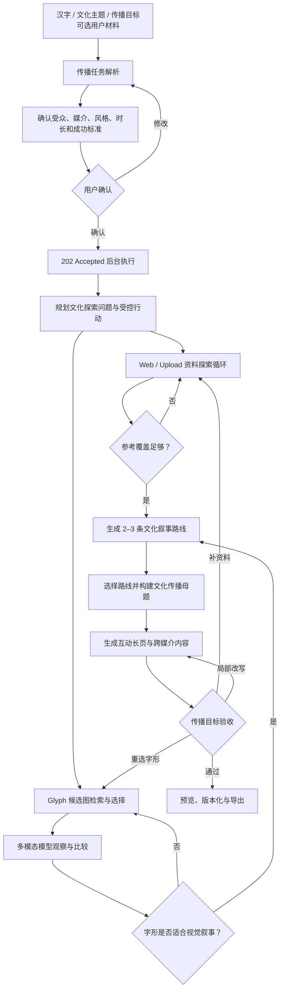

# 字脉产品需求文档（PRD）

> 项目名称：字脉——多模态汉字文化叙事与传播智能体
> 文档版本：v1.7
> 文档状态：图文作品预览、自然语言局部修改与五格式导出已实施
> 最后更新：2026-08-29
> 目标提交日期：2026-09-01  
> 适用范围：产品、设计、前端、后端、智能体、数据与评测开发

---

## 1. 文档目的

本文档用于统一“字脉”比赛版的产品目标、用户流程、功能边界、交付效果和验收标准，并作为后续交互设计、技术方案、任务拆解和测试工作的依据。

后续开发应优先保证本文档定义的 P0 闭环完整可用。未经评审，不新增与主闭环无关的功能。

---

## 2. 产品概述

### 2.1 产品定位

“字脉”是一款面向汉字文化内容创作者、文化教育者与文化爱好者的可持续对话、多模态文化传播智能体。

用户主要在右侧对话栏提出需求，可以直接提问、研究字形、讨论传播角度，也可以要求智能体生成、修改或转换任意形式的文化传播内容。系统不预设“只能生成互动页、卡片和视频脚本”；作品形式、长度、语气、受众和结构由用户在对话中决定。

智能体会结合最近对话、当前作品、网络内容、用户上传资料，以及从 PostgreSQL/MinIO 取得的真实历代字形，自主判断本轮需要回答、探索、创作、修改、转换还是澄清。涉及真实字形观察时由多模态模型读取已标注图片；不需要资料或图片时不强行调用工具。

参考资料用于给大模型提供生成上下文并向用户说明“模型参考了什么”；系统不执行逐句证据绑定、来源等级评定或事实核验。上传材料不用于识别或释读未知古文字。

### 2.2 一句话定义

> 和一个真正理解字形的智能体对话，把汉字文化变成你需要的任何传播内容。

### 2.3 核心价值

当前汉字文化传播通常需要创作者在字形资料、文化背景、网络内容和不同媒介之间反复搜索、挑选和改写。通用大模型虽然会写文案，但很少真正读取历代字形，也不会主动发现什么角度更适合当前受众和渠道。

“字脉”解决的不是“按按钮生成一篇讲解”，而是让汉字资料、字形观察和内容创作发生在同一段可持续对话中：

1. 从网络、用户资料和真实字形中自主发现多个文化叙事切口；
2. 将多模态字形观察转化为普通观众能看懂、能参与的视觉叙事；
3. 用户可自由指定广播稿、课程活动、展签、社交文案、触摸屏文案等任意内容形式；
4. 用户可以用自然语言连续追问、要求局部修改，或把当前作品转换成另一种媒介；
5. 每次修改都形成可恢复版本，网络资料、上传文档和字形图片按需复用，不必重复开始任务；
6. 界面展示简明行动判断和工具动作，但不展示模型私有思维过程。

---

## 3. 产品目标与非目标

### 3.1 比赛版目标

比赛版默认实现以下完整闭环：

```text
汉字 / 文化主题 / 传播需求（可选当前任务资料）
→ 进入三栏对话工作台
→ 判断 answer / explore / create / revise / transform / clarify
→ 按需调用 Web、Upload、Glyph 与多模态观察工具
→ 直接回答，或生成用户指定形式的完整作品
→ 中间区域自动切换到字形、资料或作品视图
→ 用户继续追问、修改或转换
→ 保存对话、作品谱系、版本和工具轨迹
→ 分页文档/幻灯片预览与 Word、HTML、TXT、PDF、PPT 导出
```

比赛版最终交付四个产品能力：

1. 在同一任务中进行可持久化的多轮问答、讨论和创作；
2. 根据语义自主决定是否调用网络、用户资料、真实字形和多模态观察；
3. 生成用户要求的任意传播形式，而不是从固定成品菜单中选择；
4. 对当前作品连续修改或跨媒介转换，并保留可恢复的版本谱系；
5. 在前端以分页文档或幻灯片预览图文作品，并导出 Word、HTML、TXT、PDF、PPT 五种格式。

文化传播页提供五类高频创作起点：文化文章、讲解与播客稿、图文卡片方案、教育内容、视频脚本。它们用于帮助用户表达需求，不是后端枚举限制；用户仍可直接要求其他文本或图文策划形式。视频与动画类请求只交付视频脚本，不进入视频渲染、合成或文件导出流程。

原有 CommunicationBrief、叙事路线、统一母题和三类传播包保留为可选“深度策划模式”，不再是普通对话和创作的前置步骤。

### 3.2 明确不做

比赛版不包含：

- 未知古文字图像识别；
- 甲骨文自动释读或“破解”；
- 整片拓片 OCR 与全文翻译；
- 根据一张残损古文字图片直接判断现代汉字；
- 自训练通用或垂直大语言模型；
- VR、AR、数字人；
- 文创商品与图片 AIGC；
- 完整视频自动生成；
- 视频渲染、动画合成与 MP4 等视频文件导出（仅保留视频脚本）；
- 覆盖全部汉字；
- 代替文字学专家给出学术定论。

### 3.3 多模态边界

多模态字形观察是比赛主演示能力：系统不要求用户上传或识别未知古文字，而是把图 RAG 已从数据库选出的、目标字和书体标签均已确定的字形图片交给视觉模型，提取外轮廓、构件位置、疏密和线条形态。图片和文档上传仍是辅助上下文入口；未知古文字识别、以图搜图和视觉字形分类不在产品范围内。

图片可用于读取：

- 教材或课程页面；
- 博物馆展品及展签；
- 汉字文化海报；
- 已知汉字的演化资料截图；
- 用户已有的讲解内容。

如果图片中只包含无法确认的古文字字形，系统必须要求用户补充目标现代汉字或相关说明，不得自行给出确定释读。比赛主演示优先直接选择“云、雷、礼、明”之一，避免把 OCR 准确率误当作核心创新。

---

## 4. 目标用户

### 4.1 主要用户

#### 用户 A：汉字文化内容创作者

目标：把一个汉字迅速发展成有视觉记忆点、故事张力和互动性的文化内容。

痛点：资料、字形与媒介文案分散；通用模型能写，却不会主动找角度、选视觉素材和统一多媒介叙事。

#### 用户 B：文化机构新媒体与公共文化传播人员

目标：围绕节日、主题活动或日常文化传播，产出可在官网、公众号和短视频中复用的内容套件。

痛点：一个主题需要反复改写成多种版本，字形素材与文案常常互相脱节。

#### 用户 C：文化教育与汉字文化爱好者

目标：将一个汉字改编成适合课堂、社群或自主学习的可视化文化故事。

痛点：现有内容要么过于学术化，要么只有简化文案，缺少真实字形、观察引导与互动设计。

### 4.2 次要用户

- 国际中文教育者；
- 学生与普通观众；
- 文化自媒体团队。

比赛演示默认使用“文化内容创作者”身份。

---

## 5. 核心使用场景

### 5.1 场景一：先讨论，再决定是否创作

用户输入：

> 先和我聊聊“礼”字有哪些适合年轻人的传播切口，不要马上生成作品。

系统输出：

- 直接以对话形式提出若干切口，不创建作品；
- 用户继续追问其中一个角度时承接上一轮上下文；
- 涉及历代字形比较时，按需调取代表图并进行多模态观察；
- 用户随后说“把第二个切口写成校园广播稿”时才创建作品。

### 5.2 场景二：使用用户资料定制传播内容

用户可以上传含有清晰现代文字的展签照片或资料文档，并输入：

> 参考这份活动方案和历史材料，围绕“礼”设计一条适合公众号和短视频的文化叙事。

系统需要：

1. 只提取图片或文档中明确出现的现代文字、年代和主题；
2. 结构化任务要求并让用户确认；
3. 制定资料探索与字形观察计划；
4. 完成网络/用户资料检索和字形多模态观察；
5. 产生多条可选叙事路线，并说明各自的传播重点；
6. 形成选定路线的跨媒介传播内容；
7. 检查媒介长度、受众、视觉素材使用和互动要求，不满足时定向修改；无法确认现代目标字时停止并要求用户补充。

### 5.3 场景三：自由创作、连续修改与跨媒介转换

用户在结果页补充：

> 把当前校园广播稿的开头缩短，保留后面的主要内容。

修改完成后，用户继续输入：

> 再把它改成博物馆触摸屏首页的 80 字开场白。

系统复用最近对话、当前选中作品、参考资料和字形观察。第一次修改在原作品谱系上创建新版本；第二次转换创建新的作品谱系并记录父作品关系，不无条件重跑资料探索。

### 5.4 场景四：任意内容形式

用户可以直接要求：课程导入活动、亲子互动题、文博展签、播客提纲、社交媒体帖子、讲解员串词或未预设的新形式。`artifact_type` 为自由文本，由模型结合用户要求生成；系统不因前端没有对应模板而拒绝。

---

## 6. 产品信息架构

```text
首页
├── 自然语言需求输入
├── 可选图片/PDF/DOCX 上下文
├── 对话式示例
└── 进入汉字研究或文化传播

汉字研究
├── 字形演化：历史主时间线、草书支线、异体图库与图像对比
├── 研究资料：网络内容、上传文档与本轮参考上下文
└── 研究结果保留在当前任务中，可直接交给文化传播继续使用

文化传播
├── 创作起点：文章 / 讲解与播客稿 / 图文卡片方案 / 教育内容 / 视频脚本
├── 创作作品：自由作品类型、预览、版本与导出
├── 任务进展：计划、行动与工具执行摘要
└── 复用当前任务的研究上下文，不要求用户重新输入

固定三栏布局
├── 左栏：首页 / 汉字研究 / 文化传播
├── 中栏：当前一级工作空间及其内部视图
└── 右栏：跨工作空间持续存在的智能体对话

创作作品
├── 自由作品类型与完整 Markdown 内容
├── 视频类需求仅保存脚本，不生成视频文件
├── 同谱系修改版本
├── 跨媒介父子作品
└── 当前版本预览与导出
```

---

## 7. 核心用户流程



---

## 8. 功能需求

### 8.0 FR-000：持续对话与自由作品（P0，默认入口）

用户创建任务后直接进入三栏工作台。右侧对话栏必须支持：

- `answer`：回答问题或继续讨论，不创建作品；
- `explore`：按需读取网络、上传资料或真实字形，并返回探索结果；
- `create`：生成用户指定形式的完整作品；
- `revise`：修改当前或明确选中的作品，创建同谱系新版本；
- `transform`：将当前作品转换为新形式，创建带父作品关系的新谱系；
- `clarify`：缺少会实质影响结果的要求时提出简短问题。

作品类型、格式标签、标题、摘要和正文均由当前需求决定。后端把模型正文整理为统一 `RichArtifactDocument`，其中页面、内容块和图片都具有稳定 ID，作为前端预览、局部修改和五种导出的唯一内容来源。系统不得把未识别的新形式强制映射成互动页、五张卡片或 60 秒视频。消息和作品必须保存到 PostgreSQL，刷新页面或重启容器后能够恢复。

每轮返回 `workspace_view`：字形或资料探索自动进入“汉字研究”，作品生成、修改或转换自动进入“文化传播”；普通问答保持当前工作空间。中间区随动作切换内部视图，同时展示行动摘要和已调用工具名称，不展示模型私有思维过程。

### 8.1 FR-001：自然语言任务输入（P0）

比赛版用户输入一个现代汉字、文化主题或传播目标，可包含：

- “云、雷、礼、明”中的单个汉字；
- 希望传达的文化感受或核心主题；
- 受众、传播媒介、时长、语气和互动要求。

系统应提取：

- 目标汉字；
- 传播目标与文化主题；
- 目标受众；
- 传播媒介；
- 预计时长；
- 表达风格与语言；
- 需要交付的内容形式；
- 传播成功标准；
- 必须包含的内容；
- 禁止或需要谨慎处理的内容。

验收条件：默认对话入口可以直接使用这些信息；只有进入深度策划模式时才要求展示并确认完整结构化结果。

### 8.2 FR-002：图片上下文输入（辅助能力，非主演示）

支持 JPG、PNG、WEBP。

系统使用 OCR/VLM 尝试提取：

- 图片中的现代汉字和文字说明；
- 文物或展品名称；
- 图片中明确给出的年代；
- 用户可能关注的文化主题。

如果无法确认目标现代汉字，必须询问用户，不自动进行古文字释读。图片上传失败不应阻断纯文字主演示流程。

### 8.3 FR-003：文档上下文输入（辅助能力，非主演示）

支持 PDF、DOCX、TXT、Markdown。

系统提取：

- 已有讲解内容；
- 课程或传播要求；
- 目标受众；
- 篇幅和时长要求；
- 用户已提供的引用和来源。

系统需要区分“用户提供的材料”与“系统检索的新材料”。

### 8.4 FR-004：深度策划任务确认（兼容能力）

进入 Brief→叙事路线→传播包的深度策划模式前展示：

```text
目标汉字
传播目标
目标受众
传播媒介
预计时长
表达风格
交付内容套件
历史阶段要求
互动要求
成功标准
其他限制
```

用户可直接修改任一字段。普通问答、自由创作、修改和转换不得被该确认步骤阻塞。

### 8.5 FR-005：执行计划生成（P0）

规划 Agent 根据 CommunicationBrief 和当前工具目录生成可执行计划。计划不强制为固定八步，但必须受程序层允许的阶段、工具、循环上限和路由动作约束。每一步记录：

- 目标；
- 逻辑职责；
- 所需工具；
- 输入依赖；
- 完成状态；
- 失败后的下一动作。

允许的路由动作至少包括 `SEARCH_MORE`、`REWRITE_QUERY`、`RESELECT_GLYPH`、`BUILD_NARRATIVES`、`REWRITE_ASSET`、`ASK_USER` 和 `FINISH`。每个动作必须同时输出面向用户的决策摘要，不展示模型内部思维过程。

用户界面只展示计划、行动和结果摘要，不展示模型内部思维过程。

### 8.6 FR-006：历代字形检索（P0）

系统根据目标汉字获取可用历史字形，包括但不限于：

- 商代文字中的甲骨文与金文材料；
- 西周、春秋金文等材料；
- 战国六国文字与秦系文字；
- 秦小篆；
- 秦隶与汉隶；
- 行书与楷书；
- 作为书写支线的草书；
- 现代规范字，以及适用时的简化字、繁体字关系。

上述项目不是必须首尾相接的单线书体序列。系统以秦篆、秦隶为古文字与今文字的分水岭，主时间线和书写支线遵循 [汉字演化分期与展示规范](./EVOLUTION_FRAMEWORK.md)。

每个字形记录至少包含：

- 字形图片；
- 历史阶段；
- 大致年代；
- 来源名称；
- 来源编号或链接；
- 是否为异体；
- 使用许可或引用方式。

历史分期、书体/资料类型、主干或支线角色、地域文字系统和单图可靠年代必须分开记录。

系统不得为了补齐时间线而生成不存在的历史字形。

### 8.7 FR-007：代表字形选择（P0）

同一时期存在多个异体时，系统需要选择适合当前任务的代表字形，并保留查看其他异体的入口。

选择依据包括：

- 来源明确；
- 图像完整；
- 具有代表性；
- 能与前后阶段比较；
- 适合目标受众理解。

系统应允许：

- 一对多；
- 多对一；
- 异体并存；
- 演化断层；
- 不同学术观点。

不得将复杂演化强行表达为唯一线性路径。

### 8.8 FR-008：多模态字形视觉观察（P0）

图 RAG 选出代表图后，系统必须调用配置的通用多模态大模型读取图片，并输出：

- 每张代表图可见的外轮廓、构件相对位置、方向、疏密和线条形态；
- 主时间线相邻图片的可见差异；
- 隶书代表图与草书支线代表图的可见差异；
- 模型名称、降级状态和观察边界。

模型输入同时包含已由数据库确定的目标汉字、书体标签和图片 ID。模型不得重新猜字，不得仅凭图片判断年代、出处、本义或直接传承关系。输出中的图片 ID、书体和允许比较对必须经程序校验；模型失败时显示降级状态，不使用文本模型补写视觉细节。

字形观察不只是生成正文的附加段落，还必须进入文化叙事路线的视觉钩子、图片顺序和观众引导问题。只要存在有效观察，最终互动长页必须显式引用对应图片 ID 和“图中可见”的特征；文本模型忽略时，由程序从结构化观察结果确定性补入。

### 8.9 FR-009：生成参考资料混合检索（P0）

生产任务的参考资料只有两类：

1. Web Search；
2. 当前任务的 User Upload。

Web Search 计划经过“搜索结果→抓取正文→解析→切分相关片段→保存任务快照”。当前仓库只完成 Provider 接口、配置和受控不可用路径，尚未接入真实搜索 backend；未配置时返回 reference gap，不得改用 Stage 7 固定夹具。

用户资料必须按 `task_id` 与 `asset_id` 隔离，解析后写入当前任务 Reference Snapshot。

已经形成的任务快照使用结构化字段、PostgreSQL 全文、pgvector 向量和 RRF 检索；召回排序不再叠加 A/B/C/D 权威加分。

检索结果必须保留：

- 来源；
- 标题；
- 作者或机构；
- 发表时间；
- 原文片段；
- 链接或书目；
- 片段可用性；
- 获取时间和内容哈希；

现有 68 条 Stage 7 片段仅作为 `fixture`、回归评测和离线开发语料，不是生产知识源。

### 8.10 FR-010：生成上下文组织（P0）

系统将字形阶段、视觉观察、网络片段和用户资料整理为文化切口发现与传播内容生成共用的 `CultureContextPackage`。

#### 字形演化层

描述历史字形和构件如何变化。

字义与文化内容由大模型参考检索上下文生成。系统提示模型避免补充上下文中没有出现的具体年代、出处、器物名称和确定性传承关系，但不执行事实核验。文化切口发现只能从当前任务的字形和参考上下文中提取素材，不能为追求传播效果伪造历史转折。

### 8.11 FR-011：文化叙事探索工作台（P0）

工作台应包含：

1. CommunicationBrief 与成功标准；
2. 当前资料探索问题、缺口和下一动作；
3. 可交互历史时间线、草书支线、代表字形和异体图库；
4. 多模态字形观察与建议的视觉叙事顺序；
5. 2–3 条可选 `NarrativeRoute`；
6. 本次提供给模型的参考资料；
7. 行动、路由、回退和定向返工摘要。

交互要求：

- 点击阶段查看详情；
- 前后字形并排或叠加比较；
- 查看其他异体；
- 展开查看网络或用户资料片段；
- 预览并选择不同文化叙事路线。

### 8.12 FR-012：文化切口与传播母题生成（P0）

大模型输入必须包含：

- 已确认的 `CommunicationBrief`；
- 目标汉字的字形阶段描述；
- 网络搜索与用户资料的相关片段；
- 资料标题、作者/机构和链接或附件位置；
- 受众、传播目标、媒介、时长、风格和互动要求。

模型首先输出 2–3 条结构化 `NarrativeRoute`：

```text
路线名称
文化核心观点
开场钩子
字形视觉钩子与图片 ID
叙事结构
当代连接方式
适用受众与媒介
本次参考片段 ID
```

用户选择或智能体推荐一条路线后，系统再生成 `CommunicationPackage`。

### 8.13 FR-013：生成边界与降级（P0）

系统不执行：

- 逐句证据绑定；
- Claim–Evidence 支持关系判断；
- 来源冲突裁决；
- 史实真伪判断；
- 内容准确性承诺。

系统应：

```text
- 明确显示本次提供给模型的参考资料；
- 未检索到资料时提示参考上下文不足；
- 外部模型不可用时使用本地模板降级；
- 在界面和导出中说明资料增强只能降低幻觉风险。
```

### 8.14 FR-014：旧证据结构兼容（P2）

数据库中的 `claims`、`claim_evidence`、`audit_runs`、A/B/C/D 和支持关系字段仅用于读取历史任务与回归夹具。新生产任务不创建 Claim，不调用检查节点，也不依赖这些字段决定是否生成。

### 8.15 FR-015：跨媒介文化传播内容套件（P0）

系统由配置的大模型参考任务级网络与用户资料生成文化传播内容；未配置模型时使用本地模板降级。

比赛版必须以同一文化母题交付：

- 互动文化长页：标题、开场钩子、视觉字形叙事、文化故事、当代连接、互动问题与参考资料；
- 图文卡片文案：默认 5 张，每张包含标题、正文、建议图片 ID 和承接关系；
- 60 秒短视频脚本：开场、分镜节奏、画面建议、旁白、互动句与结尾。

公众号文章提纲、中英双语文化卡与 30 秒脚本列为 P1。系统不自动发布到第三方平台。

### 8.16 FR-016：受众、媒介与风格适配（P0）

用户可设置：

- 青少年；
- 年轻文化兴趣用户；
- 成人文化爱好者；
- 国际中文学习者（P1）。

系统根据受众调整：

- 词汇难度；
- 句子长度；
- 背景知识量；
- 举例方式；
- 开场钩子强度与互动方式；
- 中英文表达。

媒介至少支持 `interactive_page`、`social_cards` 和 `short_video_60s`。系统根据媒介约束调整叙事节奏、内容长度、视觉密度和互动句。切换受众、媒介或时长时复用相同的参考快照、字形观察和文化母题。

### 8.17 FR-017：传播成品验收与定向返工（P0）

生成后由独立的成品验收职责检查：

- 是否完成 CommunicationBrief 中的传播目标；
- 是否实际使用选定的字形图片和可见特征；
- 是否适合目标受众；
- 是否满足目标媒介的长度、结构和互动要求；
- 多个媒介版本是否围绕同一文化母题；
- 是否展示本次提供给模型的参考资料；
- 是否将资料缺口或字形断层伪装成完整线性演变。

验收结果必须给出定向路由：参考上下文不足返回资料探索，字形不适合返回代表图选择，媒介或表达不满足只重写对应内容资产。每类循环遵守配置预算，超限后返回现有可用结果与未满足项。

### 8.18 FR-018：用户编辑与局部再生成（P0）

用户可：

- 调整目标受众、媒介、时长和风格；
- 切换文化叙事路线；
- 增删历史阶段；
- 更换代表字形；
- 修改文化母题、开场钩子或叙事节奏；
- 只重新生成某张图文卡、某段长页或某个短视频分镜。
- 在分页文档或幻灯片预览中选中具体页面、标题、段落、列表、图片或图注，再在右侧说“修改这里”；
- 对真实历史字形调整大小、位置、顺序、图注和周边文案，但不得替换、重绘或伪造原始字形。

局部修改必须携带当前 `page_id` 与 `block_id`，在同一作品谱系中创建新版本，不应触发整个研究流程无条件重跑。未选中内容块时，修改指令作用于当前作品整体。

### 8.19 FR-019：执行记录（P0）

展示：

- 当前执行步骤；
- 调用的 Agent 和工具；
- 检索到的资料数量；
- 模型探索或成品验收发现的问题；
- 回退与修正行为；
- 当前任务是否完成。

不展示模型私有推理过程。

### 8.20 FR-020：保存与导出（P0）

支持：

- 保存任务；
- 恢复任务状态；
- 中间工作区切换分页文档与幻灯片预览；
- 导出 Word（`.docx`）、独立 HTML（`.html`）、纯文本（`.txt`）、PDF（`.pdf`）和 PowerPoint（`.pptx`）；
- Word、HTML、PDF 和 PPT 嵌入作品中的真实历史字形或其他可用图片，并保持原图宽高比、不裁切；
- TXT 使用清晰的图片说明与素材提示，不声称能够嵌入图片；
- 五种导出必须来自同一份 `RichArtifactDocument`，避免预览与文件内容分叉；
- 旧 Markdown/JSON 导出只作为兼容接口保留，不进入默认作品工具栏。

导出端点返回明确的文件名和 MIME 类型。真实历史字形在文档中标为受保护素材；导出器只能排版，不得对原图进行生成式修改。

---

## 9. 智能体逻辑职责

产品对用户呈现统一的“字脉”智能体。传播任务理解、文化切口发现、资料探索、字形视觉叙事、传播母题构建、媒介适配和成品验收是同一 LangGraph 中的逻辑职责，不包装成多个独立部署的 Agent。

系统采用“确定性外层 Graph + 受控 Agent 子循环”：程序层锁定可用工具、路由枚举、图片 ID、书体、比较对、最大循环数、Token/时间预算和安全边界；模型只在文化切口、检索问题改写、代表图叙事选择和定向返工中作出结构化决策。

### 9.1 传播任务理解与规划职责

职责：

- 解析汉字、传播目标、受众、媒介、时长、风格和交付物；
- 构建并请用户确认 `CommunicationBrief`；
- 从受允许的工具和路由中生成可执行计划；
- 设置每个子循环的完成条件与预算。

退出条件：CommunicationBrief 已确认，受控计划、成功标准和预算已形成。

### 9.2 字形视觉叙事职责

职责：

- 获取历代字形候选，并从真实数据中选择适合当前受众与叙事的代表图；
- 图片编号、数据集元数据和原始存储路径仅作为内部检索字段，不得出现在智能体对话、演化展示或最终传播内容中；
- 调用多模态模型观察外轮廓、构件位置、线条形态和疏密；
- 形成可视化顺序、观察引导和建议互动问题；
- 标记断层、异体和不能表达为直接传承的阶段。

退出条件：形成至少一条可用的字形视觉叙事，或明确记录字形缺口。

### 9.3 文化资料探索职责

职责：

- 根据传播目标拆分字形、文化背景、当代连接和受众切入点问题；
- 从 Web 与当前任务 Upload 获取候选内容，形成任务快照后执行结构化、全文和向量检索；
- 检查当前资料是否足以产生区分明显的文化切口；
- 资料覆盖不足时改写检索问题，连续两轮无新信息时停止。

退出条件：形成长度受控的文化资料包，或明确标记仍然存在的参考缺口。

### 9.4 文化切口与母题构建职责

职责：

- 将字形观察、历史阶段、网络内容和用户资料组织为 `CultureContextPackage`；
- 生成 2–3 条在核心观点、视觉钩子或当代连接上有明显区分的 `NarrativeRoute`；
- 根据受众、媒介和参考覆盖给出路线推荐摘要；
- 用户选择或自动推荐后，形成统一文化传播母题。

退出条件：一条 NarrativeRoute 已选定，并形成可派生多媒介内容的文化母题。

### 9.5 跨媒介内容生成职责

职责：

- 基于同一文化母题生成互动长页、图文卡片和 60 秒短视频脚本；
- 为各媒介选择适合的字形图片 ID、叙事节奏和互动句；
- 复用母题与参考上下文，局部修改单个传播资产。

退出条件：`CommunicationPackage` 的 P0 交付物齐全。

### 9.6 传播成品验收与路由职责

职责：

- 检查文化母题一致性、受众与媒介适配、视觉素材使用、长度和互动要求；
- 不与生成职责共用“已完成”判断；
- 输出 `SEARCH_MORE`、`RESELECT_GLYPH`、`REWRITE_ASSET`、`ASK_USER` 或 `FINISH` 之一；
- 将返工限定在对应子图，不默认从头执行。

退出条件：成功标准已满足，或达到循环上限并向用户说明未满足项。

---

## 10. 核心数据对象

### 10.1 CommunicationBrief（由 TaskSpec 演进）

```json
{
  "target_characters": ["礼"],
  "communication_goal": "让年轻观众从字形看见‘礼’的文化故事",
  "theme": "礼与当代生活",
  "audience": "年轻文化兴趣用户",
  "channels": ["interactive_page", "social_cards", "short_video_60s"],
  "tone": ["有文化感", "不过度学术"],
  "duration_seconds": 60,
  "deliverables": ["interactive_story", "five_cards", "video_script"],
  "required_stages": 3,
  "interaction_count": 2,
  "success_criteria": ["字形图片进入叙事", "三类内容共用同一文化母题"],
  "language": "zh-CN",
  "constraints": ["争议观点不得写成定论"],
  "web_search_enabled": true
}
```

旧 `TaskSpec` 继续作为数据库与 API 兼容对象；新字段通过迁移渐进式加入，不在一次变更中删除旧字段。

### 10.2 GlyphStage

```json
{
  "stage_id": "glyph-stage-001",
  "character": "礼",
  "script_type": "金文",
  "period": "商周文字",
  "image_url": "...",
  "source_id": "glyph-source-jiezi",
  "source_label": "JieZi-Dataset",
  "source_url": "...",
  "source_license": "...",
  "variant_type": "representative",
  "structure_description": "...",
  "change_from_previous": "..."
}
```

### 10.3 ReferenceSnapshot（数据库兼容名：Evidence）

`Evidence` 是现有数据库与 API 的兼容名称，产品界面统一称为“参考资料”。它表示模型本次生成实际读取的任务级快照，不表达来源评级、事实裁决或逐句支持关系。

```json
{
  "evidence_id": "evidence-001",
  "task_id": "task-001",
  "source_id": "source-web-001",
  "origin": "web",
  "source_type": "web_page",
  "title": "...",
  "author_or_org": "...",
  "publication_date": "...",
  "quote_or_summary": "...",
  "locator": "...",
  "url": "...",
  "retrieved_at": "...",
  "usability": "usable",
  "content_hash": "...",
  "license": "link-only"
}
```

### 10.4 Legacy Claim（仅历史任务兼容）

新生产任务不创建 Claim。以下结构只用于读取旧任务和回归数据：

```json
{
  "claim_id": "claim-001",
  "content": "资料正文直接表达的候选陈述。",
  "claim_type": "literature_fact",
  "claim_origin": "evidence_derived",
  "evidence_ids": ["evidence-001"],
  "evidence_relations": [
    { "evidence_id": "evidence-001", "support_type": "supports" }
  ],
  "has_conflict": false,
  "audit_status": "approved"
}
```

### 10.5 EvolutionPackage

```json
{
  "character": "礼",
  "glyph_stages": [],
  "shape_changes": [],
  "meaning_changes": [],
  "cultural_contexts": [],
  "references": [],
  "controversies": [],
  "visual_hooks": []
}
```

旧任务中的 `claims`、`evidence` 与 `audit_summary` 字段继续兼容读取，新生产任务不依赖这些字段完成路由。

### 10.6 NarrativeRoute

```json
{
  "route_id": "route-visual-01",
  "title": "从字形看见礼",
  "core_message": "...",
  "opening_hook": "...",
  "visual_hooks": [{ "image_id": "U+793C/J/1", "prompt": "..." }],
  "story_beats": ["..."],
  "contemporary_connection": "...",
  "recommended_channels": ["interactive_page", "short_video_60s"],
  "reference_ids": ["evidence-001"]
}
```

### 10.7 CommunicationPackage

```json
{
  "brief_id": "brief-001",
  "selected_route_id": "route-visual-01",
  "cultural_motif": {
    "title": "...",
    "core_message": "...",
    "visual_sequence": []
  },
  "interactive_story": {},
  "social_cards": [],
  "short_video_script": {},
  "reference_ids": [],
  "evaluation": {}
}
```

---

## 11. 页面与交互要求

### 11.1 任务创建页

必须包含：

- 项目名称和一句话说明；
- 大尺寸自然语言输入框；
- 受众、传播媒介、表达风格与时长快捷设置；
- 可选图片/文档上下文上传；
- 示例任务；
- 开始执行按钮。

默认示例：

> 围绕“礼”制作一套面向年轻人的汉字文化内容，用于互动长页、五张图文卡片和 60 秒短视频，有文化感但不要太学术。

### 11.2 智能体工作台

采用固定三栏布局：

- 左栏：仅保留“首页 / 汉字研究 / 文化传播”三个一级入口，并显示当前任务与连接状态；
- 中栏：按当前空间展示字形演化、参考资料、图文作品或任务进展；作品视图支持分页文档/幻灯片切换、页面缩略图、内容块点选和五格式导出；
- 右栏：持续存在的智能体对话、公开行动摘要、工具动作和输入框。用户选中中栏内容块后，可直接用“修改这里”等自然语言发起局部新版本。

执行日志作为可折叠辅助信息，不占据主视觉层级，也不展示模型私有思维过程。

### 11.3 文化传播页

必须包含：

- 由用户需求决定的文化传播作品，而非固定三类成品；
- 图文分页文档和幻灯片两种实时预览；
- 页面缩略图、当前页状态与内容块选中反馈；
- 真实历史字形的公开书体图注，不显示图片编号、代码点、数据集名称或存储路径；
- Word、HTML、TXT、PDF、PPT 五种导出；
- 右侧对话驱动的整体修改、局部修改和跨媒介转换；
- 视频类请求仅生成可编辑脚本，不生成或导出视频文件。

---

## 12. 状态与异常处理

### 12.1 任务状态

```text
草稿
待确认
规划中
检索中
演化构建中
上下文整理中
传播生成中
待用户确认
已完成
部分完成
失败
```

### 12.2 常见异常

#### 无法确认目标汉字

提示用户选择或输入目标现代汉字。

#### 历史字形资料不足

不得生成占位假字形。展示已有阶段并明确资料缺口。

#### 来源冲突

作为不同叙事材料并列保留；模型不得把互相矛盾的表述合并成单一确定结论。

#### 来源不可访问

保留已有标题和链接状态；若没有可读取正文，则不把该链接内容写入生成上下文。

#### 智能体执行失败

自动重试一次；仍失败则保留已完成状态，允许用户从失败节点继续。

#### 用户上传未知古文字图片

明确说明比赛版不提供未知古文字识别，请用户补充目标汉字或图片说明。

---

## 13. 非功能需求

### 13.1 性能

- 任务结构化结果目标在 5 秒内返回；
- 普通单字完整任务目标在 120 秒内完成；
- 页面交互响应目标小于 300 毫秒；
- 长任务支持流式展示进度；
- 单个任务失败不得导致整个服务不可用。

### 13.2 可恢复性

- LangGraph 状态需要持久化；
- 页面刷新后可恢复当前任务；
- 每个 Agent 节点支持独立重试；
- 用户可从最近成功节点继续。

### 13.3 可审计性

- 记录工具调用、检索资料、模型输出和传播成品验收结果；
- 支持按照 `task_id` 查看完整执行轨迹；
- 记录模型版本、提示词版本、数据版本和执行时间；
- 不向最终用户展示私有推理内容。

### 13.4 数据与版权

- 记录每张字形图片和每段资料的来源及许可；
- 未明确授权的素材仅提供链接或符合许可的缩略引用；
- 使用汉字字源网等第三方资料前确认抓取、展示和再分发权限；
- 比赛材料中列明数据、算法、模型和外部服务来源；
- 用户上传文件默认仅用于当前任务。

### 13.5 安全与质量

- 上传文件限制类型和大小；
- 对文档内容进行提示注入隔离；
- 外部资料不能直接改变系统规则；
- 所有生成内容标记为辅助结果；
- 明确展示本次生成实际参考的资料与字形素材；
- 不对参考来源划分质量等级，也不暗示系统已经完成事实核验。

---

## 14. 数据范围

### 14.1 比赛版覆盖目标

- 只将“云、雷、礼、明”4 字纳入比赛演示数据库；
- 共使用 328 张 JieZi 原图，4 字均具有甲骨、金文、战国、篆、隶、楷、草七类目录样本；
- 保留 68 条 Stage 7 回归/演示证据片段，用于固定检索评测和离线 workflow fixture，不进入默认生产 Evidence Router；
- 每个时间线节点保留图片来源、数据集路径、许可和证据边界；
- 以 4 个可重复运行的精品案例代替“先覆盖 100/200 字”的数据扩张。

### 14.2 首批汉字

```text
云、雷、礼、明
```

其他 JieZi 图片只保留在本地原始下载目录，比赛功能、数据库和 Docker 镜像均不依赖它们。完整功能和专业内容稳定后，才按相同许可、证据和验收流程扩充。

### 14.3 核心演示案例

1. 礼：适合作为汉字文化与制度语义的主演示案例；
2. 明：异体样本丰富，适合展示图库、两阶段观察和资料增强内容生成；
3. 云、雷：用于验证同一工作流在不同构形和语义主题下的动态计划与检索行为。

---

## 15. 产品指标与评测

### 15.1 产品目标指标

下表区分“已经实测”和“仍需补充”，禁止把工程回归测试解释为文字学专家准确率。

| 指标                     |         当前结果 | 结论边界                                 |
| ------------------------ | ---------------: | ---------------------------------------- |
| 黄金检索 Recall@10       |      20/20，100% | 仅针对四字固定演示语料                   |
| 七类书体目录覆盖         |           4/4 字 | 目录类别不等于单图精确断代               |
| 图片入库完整性           |          328/328 | 校验数据库与对象存储，不评价字形学正确性 |
| Stage 7 fixture 入库     |            68/68 | 仅用于回归/离线夹具，不代表权威知识库    |
| 后端自动化测试           |        64 项通过 | 工程质量指标，不代表生成内容准确率       |
| 文字学专家一致性         |           未评测 | 比赛打磨阶段需补充                       |
| 真实用户受众适配         |           未评测 | 需文化内容创作者或目标受众试用           |
| 平均模型成本与端到端耗时 | 尚未形成正式统计 | 需增加运行记录汇总                       |

### 15.2 智能体指标

- CommunicationBrief 结构化成功率；
- 叙事探索循环在预算内完成率；
- Agent 下一动作路由正确率；
- 无效或重复工具调用比例；
- 资料/字形缺口触发定向补充的成功率；
- 局部返工命中率，即未无故重跑完整流程的比例；
- 平均循环次数、任务时长、Token 与模型成本。

### 15.3 字形视觉叙事指标

- 阶段顺序与目录标签一致率；
- 图片完整展示率；
- 代表图与异体图切换成功率；
- 视觉观察引用具体图片的比例；
- 选中视觉钩子进入传播成品的比例；
- 对不存在直接传承关系的阶段避免强行连线的比例。

### 15.4 文化传播成品指标

- 2–3 条叙事路线的差异度与可选择性；
- 同一文化母题在互动长页、图文卡片和短视频中的一致率；
- 参考资料与字形图片的实际利用率；
- 受众、媒介、风格和时长约束满足率；
- 开头钩子、当代连接与互动设计完整率；
- 目标受众理解度、兴趣度与分享意愿评分；
- 用户人工修改量和单资产局部再生成成功率。

---

## 16. P0、P1 与 P2 优先级

### 16.1 P0：比赛必须完成

- 自然语言任务输入；
- CommunicationBrief 结构化与用户确认；
- 受控 Agent 计划、预算和下一动作路由；
- 历代字形检索；
- 代表字形选择；
- 多模态字形观察、阶段对比与视觉钩子提取；
- Web Search 与用户资料的任务级混合检索；
- 资料探索与字形探索两个受控循环；
- 2–3 条差异化文化叙事路线；
- 用户选择路线或接受 Agent 推荐；
- 统一文化母题；
- 互动文化长页、五张图文卡片和 60 秒短视频脚本；
- 受众、媒介、风格与时长适配；
- 传播成品独立验收与定向返工；
- 局部编辑、再生成、执行记录、保存和导出；
- 图文分页/幻灯片前端预览、块级选择与自然语言修改；
- Word、HTML、TXT、PDF、PPT 五格式一致性导出；
- 一套覆盖 Agent 行为和传播成品的定量评测。

多模态模型对系统已知字形图片的观察属于主演示能力。图片和文档上传仍作为辅助入口；未知古文字识别、以图搜图和视觉字形分类不进入 P0。

### 16.2 P1：P0 稳定后实现

- 语音输入和语音讲解；
- 国际中文学习者版本；
- 中英双语文化卡；
- 公众号文章提纲和 30 秒短视频模板；
- 更丰富的字形叠加与动画；
- 专家协作批注；
- 图片/文档上下文入口的稳定性和可用性加固；

### 16.3 P2：比赛后规划

- 移动端；
- 多人协作；
- 用户长期学习记录；
- 博物馆内容管理后台；
- 开放 API 和插件；
- 更大规模汉字覆盖。

---

## 17. 比赛演示脚本要求

五分钟演示使用一个端到端任务，不进行零散功能浏览。

### 0:00—0:35：文化传播任务输入

从首页选择“礼”，输入：“围绕‘礼’制作一套面向年轻人的汉字文化内容，用于互动长页、五张图文卡片和 60 秒短视频，有文化感但不要太学术。”可附加一份活动背景资料。真实 Web Search backend 接入前，正式演示不能把 Stage 7 fixture 当作网络资料。

### 0:35—1:20：任务确认与智能体规划

展示系统提取的传播目标、受众、媒介、风格、交付物和成功标准；用户确认后，工作台显示当前探索问题、预算、下一动作和简明决策摘要。

### 1:20—2:20：字形视觉探索

展示历史主时间线、草书支线、真实代表字形和同文体异体图库；展开多模态模型生成的单图观察、阶段对比与可用于传播的视觉钩子，不宣称阶段间必然直接传承。

### 2:20—3:00：文化资料探索

展示 Agent 如何围绕传播目标形成搜索问题、读取网络内容与用户资料，并在信息足够或预算耗尽时停止。界面说明这些是模型本次参考的资料，不代表系统完成事实核验。

### 3:00—3:45：叙事路线选择

展示 2–3 条差异化叙事路线，例如“从字形看见礼”“礼如何进入日常秩序”“古老形式与当代表达”，并选择其中一条形成统一文化母题。

### 3:45—5:00：跨媒介生成与定向修改

展示互动文化长页、五张图文卡片和 60 秒短视频脚本如何共享同一母题与字形视觉顺序；将其中一张卡片改成更年轻的表达，系统只返工该资产。最后展示传播目标验收、参考资料记录和导出能力。

---

## 18. P0 验收清单

满足以下全部条件，比赛版才视为完成：

- [x] 用户能通过文字创建任务；
- [x] 用户可上传资料并形成仅属于当前任务的 Reference Snapshot；
- [x] 百炼 Web Search backend 返回真实标题与 URL，并将来源元数据和搜索综合摘要形成任务级快照；当前不抓取网页原文；
- [x] 系统能提取并确认完整 CommunicationBrief；
- [x] 系统能展示受控计划、探索问题、预算、下一动作和决策摘要；
- [x] 四个演示字均能检索七类书体目录的真实字形；
- [x] 核心工作流包含多模态字形观察节点，结果进入 EvolutionPackage 和最终生成上下文；
- [x] 使用真实 `qwen3.8-flash` 完成“云”字端到端烟测：7 张图、7 条单图观察、6 组对比，正文显式消费结构化视觉结果；
- [x] 使用真实 `qwen3.8-flash` 完成“云、雷、礼、明”四字视觉观察冒烟验收；
- [x] 每个阶段显示字形、年代和来源；
- [x] 网络和用户资料可以进入大模型生成上下文；
- [x] 工作台可展开查看本次生成参考资料；
- [x] 新生产任务不创建 Claim 或执行事实核验；
- [x] 资料或字形不足会触发定向补充、询问用户或带缺口继续；
- [x] 系统不会为了补齐时间线生成虚假字形；
- [x] 系统能生成 2–3 条有明显差异的文化叙事路线；
- [x] 用户能选择路线并形成统一文化母题；
- [x] 系统能生成互动文化长页、五张图文卡片和 60 秒短视频脚本；
- [x] 三类传播资产能复用同一母题和已选择的字形视觉钩子；
- [x] 用户修改单个传播资产时只进行局部再生成；
- [x] 系统能显示 Agent 行动和修正记录；
- [x] 任务状态可保存和恢复；
- [x] 结果可复制或导出；
- [x] 图文作品可在前端切换分页文档与幻灯片预览，并能点选内容块发起局部修改；
- [x] 同一作品可导出 Word、HTML、TXT、PDF、PPT，图片保持比例且不裁切；
- [x] 四个核心案例在真实百炼 Web Search、Embedding、文本模型与 `qwen3.8-flash` 上完成端到端演示；
- [x] 数据、模型、算法和素材来源完整记录。

工程验收证据、实测性能和已知边界见 [P0 验收记录](P0_ACCEPTANCE.md)。

---

## 19. 风险与应对

| 风险                         | 影响                   | 应对策略                                                     |
| ---------------------------- | ---------------------- | ------------------------------------------------------------ |
| 字形数据版权不清晰           | 无法公开展示或分发     | 优先使用许可明确数据；记录许可；必要时仅链接引用             |
| 演化关系存在学术争议         | 内容可能过度简化       | 提示模型避免确定性传承措辞，并向用户展示参考资料             |
| 通用模型补写错误字源信息     | 降低内容质量           | 提供网络、用户资料和已标注字形作为上下文；避免无上下文扩写   |
| 智能体工作流不稳定           | 演示失败或循环         | 节点级重试；限制最大循环；保存检查点；准备稳定演示数据       |
| 数据整理工作量过大           | 功能打磨被数据扩张拖慢 | 比赛版固定 4 字 328 图；项目稳定后再扩充，不承诺 100/200 字  |
| 图片上下文被误解为古文字识别 | 用户期待超出范围       | 主演示使用明确现代汉字；未知古文字要求补充标签；不做以图搜图 |
| 单字参考主要来自数据集元数据 | 文化叙事素材单一       | 接入真实搜索和用户资料，用多路线探索扩大可选文化切口         |
| 三类成品只是同文改写         | 缺乏跨媒介传播价值     | 为每种媒介定义独立结构约束，并用统一母题和视觉序列连接       |
| Agent 退化为固定流水线       | 无法体现智能决策       | 引入有限动作集、探索预算、状态评估和局部返工路由             |
| 功能继续扩张                 | 主闭环无法完成         | 所有新增功能必须先通过 P0 影响评审                           |

---

## 20. 版本成功定义

比赛版成功不以功能数量衡量，而以一个复杂任务能否稳定完成为准。

最终用户应能看到以下效果：

> 用户选择“云、雷、礼、明”之一并提出文化传播目标；系统理解受众、媒介和风格，自主探索网络资料、用户文档与真实历代字形，提出多条可选择的文化叙事路线；路线确定后，系统把同一文化母题和视觉线索转化为互动长页、五张图文卡片与 60 秒短视频脚本，并在某项成品不满足要求时只返工对应部分。

这就是“字脉”比赛版的最终交付效果。
