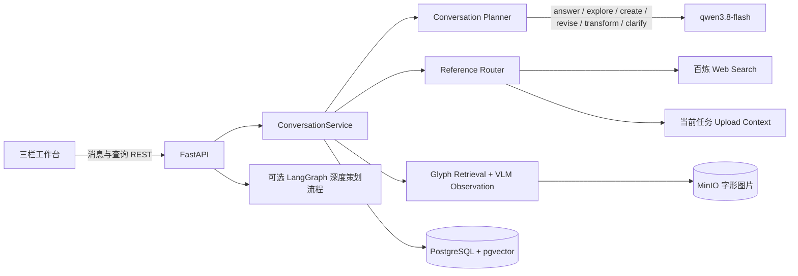
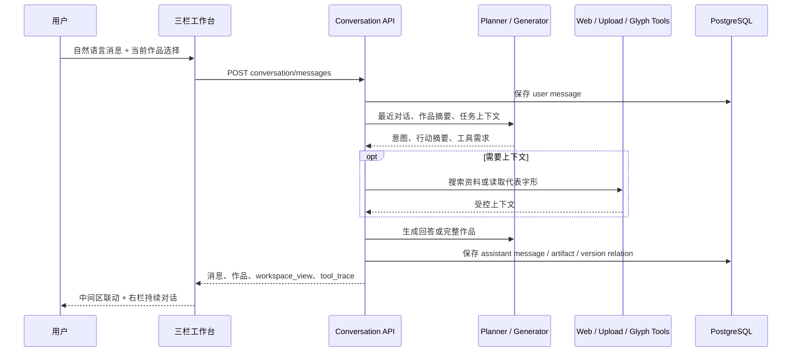
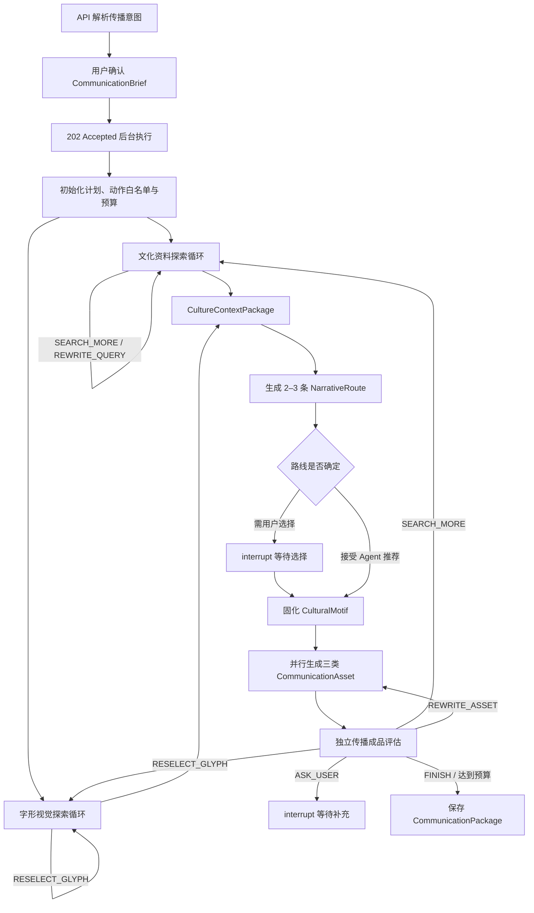

# 字脉项目设计文档

> 文档版本：v1.1
> 文档状态：通用对话式文化传播智能体已实施并完成真实模型联调
> 最后更新：2026-08-28
> 依据文档：[PRD.md](./PRD.md)  
> 演化分期依据：[EVOLUTION_FRAMEWORK.md](./EVOLUTION_FRAMEWORK.md)  
> 目标：将 PRD 转换为可实施、可测试、可逐步交付的工程方案

## 实施状态

| 阶段                         | 状态                 | 说明                                                                                             |
| ---------------------------- | -------------------- | ------------------------------------------------------------------------------------------------ |
| 阶段 0：工程骨架             | 已完成               | Web、API、PostgreSQL/pgvector、MinIO、Compose、迁移、测试与 CI 已落地并完成联调                  |
| 阶段 1：早期“鼎”夹具纵向闭环 | 已完成（历史里程碑） | 任务创建、确认、持久化工作流、固定演化包、约束检查与 Markdown 导出完成；当前已由四字真实数据替代 |
| 阶段 2：资料增强生成闭环     | 已重构               | Web/Upload Provider、任务快照、上下文组织和大模型生成已完成                                      |
| 阶段 3：多模态输入           | 已完成               | 图片/文档上传、MinIO 资产存储、本地文档解析、真实 OCR、安全确认分支与材料隔离已完成联调          |
| 阶段 4：完整交互与局部再生成 | 已完成               | 三栏工作台、演化视图、不可覆盖内容版本、局部再生成、编辑恢复、HTML/JSON/打印已完成联调           |
| 阶段 5：扩展案例与发布加固   | 已完成               | 四字 328 图演示集、PostgreSQL/MinIO 图 RAG、检查点恢复、安全/版权检查和四案例验收已完成          |
| 阶段 6：字形图库与观察对比   | 已完成               | 按汉字和文体浏览全部 JieZi 候选图、区分代表字形与异体样本、支持两阶段并排观察                    |
| 阶段 7：智能体生成闭环       | 已完成               | 68 条语料仅作 fixture；百炼真实联网搜索与任务级 URL/摘要快照已接入                                |
| 阶段 8：文化传播智能体重构   | 已完成               | Brief、双探索、路线选择、统一母题、三类成品、独立验收、单资产返工、单片段改写与整包导出已落地       |
| 阶段 9：通用对话式创作       | 已完成               | 持久对话、自由作品类型、问答/探索/创作/修改/转换路由、作品谱系、三栏联动与真实多模态调用已落地       |

---

## 1. 设计目标

字脉比赛版采用 Web 应用形态，目标是让用户通过持续对话，把汉字文化转化为自己需要的传播内容。默认主链不要求先填写完整 Brief，也不限定最终作品类型：

```text
自然语言消息 + 可选用户资料
→ 读取最近对话与当前作品
→ 规划 answer / explore / create / revise / transform / clarify
→ 按需检索网络、用户资料或已标注字形
→ 直接回答，或生成任意形式的完整 Markdown 作品
→ 用户继续追问、修改或转换
→ 持久化消息、作品谱系、版本和工具轨迹
→ 预览与导出
```

本设计优先保证：

1. “云、雷、礼、明”四字 Glyph Assets 稳定展示，并在需要字形研究时真正交给多模态模型；
2. 问答不会自动变成作品，创作/修改/转换才产生版本化作品；
3. 作品形式为自由文本，后端和前端不依赖固定三类 Schema；
4. 最近对话、当前作品、网络、上传材料和字形观察能够按需进入当前轮；
5. 对话和作品刷新、重启后可恢复，修改与转换关系可追踪；
6. 用户能看见简明判断、工具动作和参考材料，但系统不展示私有思维过程，也不进行逐句事实核验。

当前阶段不建设微服务、不训练模型、不扩充到 200 字，也不开展基线对比或消融实验。原 Brief→路线→母题→三类传播包的 LangGraph 流程作为可选深度模式和历史兼容能力保留，不是普通对话的必经步骤。

---

## 2. 核心设计原则

### 2.1 传播闭环优先

先保证一次真实对话能从讨论进入任意形式创作，再连续完成修改、转换、刷新恢复和导出。字库扩充和更多固定模板不能替代这一核心体验。

### 2.2 先探索再创作

只有当用户要求或当前问题确实需要新资料时才探索。普通问答直接回答；明确创作可直接生成；涉及历史字形比较时才读取 Glyph Assets 和调用多模态模型。深度策划模式仍可先探索、再选择叙事路线。

### 2.2.1 对话即控制面

右侧对话栏是主要命令入口。前端不通过关键词模拟回复，也不要求用户理解内部工作流节点。每轮由服务端规划器决定意图、工具需求和中间工作区视图；用户通过“改短一点”“保留第二段”“改成展签”等自然语言继续控制当前作品。

### 2.3 资料透明而非事实裁决

系统展示本次提供给模型的资料标题、片段、链接或附件位置。用户上传和网页内容都只是生成参考，系统不据此判断史实真伪。

### 2.4 GlyphAsset 与 Evidence 分离

`glyph_images` 只提供图片、书体目录和展示元数据。图片存在不自动推出精确年代、本义、馆藏结论、学术共识或线性演化关系。

### 2.5 可控自主性

外层状态机保证确认、持久化、预算和终止；内层 Agent 只可从白名单动作中选择下一步。模型负责判断“下一步做什么”，程序负责判断“能不能做、做几次、结果是否满足结构要求”。

### 2.6 确定性约束优先

文件类型、必填字段、成品数量、时长字数、循环预算等可计算规则使用程序校验；叙事差异、受众适配、媒介表达和文化母题一致性再交给独立评估模型判断。

### 2.7 模块化单体

比赛版使用单个后端应用，内部按领域拆分模块。这样可以降低部署和调试成本，同时保留未来拆分服务的边界。

### 2.8 提供方可替换

LLM、Embedding、OCR/VLM、对象存储和检索源均通过适配器接入，业务代码不直接依赖某个厂商 SDK。

### 2.9 全流程可观察

每个工作流节点记录输入摘要、输出摘要、状态、耗时、模型与提示词版本、工具调用和错误信息，但不保存或展示模型私有思维过程。

### 2.10 历史分期与书体分类分离

汉字演化采用“历史主干 + 书写支线”，以秦篆、秦隶为古今文字分水岭。甲骨文、金文等资料类型不直接等同于互不重叠的年代阶段；草书作为并行书写支线，不作为楷书之后的线性终点。具体规则以 [汉字演化分期与展示规范](./EVOLUTION_FRAMEWORK.md) 为准。

---

## 3. 总体架构



### 3.0 默认会话时序



### 3.1 前端

- Next.js + React + TypeScript；
- 采用左侧导航、中间展示、右侧智能体对话的固定三栏结构；
- 负责持续消息、行动摘要、工具动作、字形/资料/作品联动、作品版本切换和 Markdown 导出；
- 首页创建任务后直接进入对话工作台，不要求先经过确认页；
- 旧确认、路线选择、传播包内容页继续作为深度流程兼容入口；
- 通过 REST 完成命令和查询；`run`/`resume` 返回 `202 Accepted`，工作台约每 900 ms 轮询任务状态和事件；
- 所有服务端状态以 API 为准，页面刷新后可恢复。

### 3.2 后端

- Python + FastAPI + Pydantic；
- 提供 API、文件解析、领域服务、工作流调度和导出；
- 使用 SQLAlchemy 和 Alembic 管理持久化与迁移；
- `ConversationService` 负责默认短回合路由、按需工具调用、作品版本化和消息持久化；
- 长流程仍由 LangGraph 编排，使用 PostgreSQL Checkpointer 保存检查点。

### 3.3 数据与检索

- PostgreSQL 保存任务、对话消息、自由作品及谱系、CommunicationBrief、字形、参考片段、叙事路线、文化母题、工作流事件和兼容成品版本；
- pgvector 保存文献片段向量；
- 对象存储保存上传文件、字形图片和导出产物；
- 当前四字 328 图属于独立 Glyph Assets；68 条 Stage 7 片段以 `origin=fixture` 保留，只用于测试、离线开发和评测。生产 Evidence 查询强制限定当前 `task_id` 及 `origin in {web,user_upload}`。

### 3.4 部署形态

开发环境使用 Docker Compose 启动 Web、API、PostgreSQL 和对象存储。比赛环境保持相同拓扑，优先单机部署。Redis 和独立任务队列暂不引入，只有在实测并发或进程隔离确有需要时增加。

---

## 4. 代码仓库设计

建议采用单仓库结构：

```text
CharacterVein/
├─ apps/
│  ├─ web/                      # Next.js 前端
│  └─ api/                      # FastAPI 入口、路由和依赖注入
├─ packages/
│  ├─ domain/                   # 领域模型、枚举和业务规则
│  ├─ workflows/                # LangGraph 状态、节点和路由
│  ├─ retrieval/                # 结构化、全文、向量检索与 RRF
│  ├─ providers/                # LLM、Embedding、OCR/VLM 适配器
│  └─ exporters/                # Markdown、HTML、JSON 导出
├─ data/jiezi/                  # 四字图片选择清单与导入报告（不含原图）
├─ scripts/                     # JieZi 选择、校验与导入辅助脚本
├─ apps/api/tests/              # 单元、API、工作流与阶段回归测试
├─ docs/
│  ├─ PRD.md
│  └─ PROJECT_DESIGN.md
├─ infra/compose.yaml           # Web、API、PostgreSQL、MinIO 与幂等导入服务
├─ .env.example
├─ Makefile
└─ README.md
```

Python 包保持单向依赖：

```text
api/workflows/retrieval/providers/exporters → domain
```

`domain` 不得依赖 Web 框架、数据库 ORM 或模型厂商 SDK。

---

## 5. 领域模块

### 5.1 任务模块

职责：

- 接收文字、图片和文档；
- 提取 `CommunicationBrief`，并兼容已有 `TaskSpec`；
- 管理用户确认和修改；
- 管理任务状态与版本。

规则：目标汉字无法确认时，任务必须停在 `awaiting_confirmation`，不得自行释读未知古文字。

### 5.2 字形演化模块

职责：

- 查询历代字形；
- 选择代表字形并保留异体；
- 构建阶段顺序、分支和断层；
- 记录每张图片的来源与许可。

规则：

- 历史主干按商代文字、西周春秋文字、战国六国/秦系文字、小篆、秦隶、汉隶、行书、楷书和现代规范字组织；
- 草书作为从隶书发展并参与行书形成的支线展示；
- 数据集书体标签与历史分期分开保存，不能仅凭“篆书”“隶书”目录推断精确年代；
- 资料不足时返回缺口，不生成占位假字形。

### 5.3 文化资料探索模块

职责：

- 根据传播目标生成文化探索问题；
- 调用 Web Search 与当前任务 Upload Provider；
- 根据已有结果选择继续搜索、改写查询、询问用户或结束；
- 关键词检索；
- 向量语义检索；
- 按来源、编号和年代精确检索；
- 合并、去重、排序并输出结构化参考片段。

检索结果保留标题、原始定位、链接或附件信息，供模型参考和用户查看。

规则：循环次数、搜索次数、抓取页数和上下文长度必须由程序预算约束；模型不得调用白名单之外的工具。

### 5.4 字形视觉叙事模块

职责：

- 从已标注 Glyph Assets 中检索代表图与异体样本；
- 使用多模态模型观察可见轮廓、构件位置、疏密和线条形态；
- 形成可用于开场、转场、对比和互动的视觉钩子；
- 在图片不合适时选择 `RESELECT_GLYPH`，不要求用户上传未知古文字。

### 5.5 生成上下文模块

职责：将字形阶段、网络片段和用户资料组织为长度受控的 `EvolutionPackage` 兼容上下文。

### 5.6 旧 Claim/Audit 兼容模块

`claims`、`claim_evidence`、`audit_runs` 和相关领域类型保留用于读取历史任务与旧回归夹具。新生产图不创建 Claim、不调用 Audit Provider，也不以旧状态决定是否生成。

### 5.7 叙事路线与文化母题模块

职责：基于 CommunicationBrief、参考资料和视觉钩子生成 2–3 条差异化 `NarrativeRoute`，说明核心信息、开场钩子、故事节拍、当代连接和适用媒介；用户选择或接受 Agent 推荐后，固化统一 `CulturalMotif`。

### 5.8 跨媒介传播模块

职责：基于同一文化母题分别生成互动文化长页、五张图文卡片与 60 秒短视频脚本。三个生成器共享核心信息和视觉序列，但拥有各自的媒介结构约束。

### 5.9 传播成品评估与路由模块

职责：独立检查文化母题一致性、字形素材利用、受众/媒介适配、数量、长度和互动要求，输出 `SEARCH_MORE`、`RESELECT_GLYPH`、`REWRITE_ASSET`、`ASK_USER` 或 `FINISH`。评估器不生成正文。

### 5.10 导出模块

职责：输出 Markdown、HTML 和结构化 JSON。PDF 使用浏览器打印完成，首版不在后端实现复杂排版引擎。

### 5.11 持续对话与自由作品模块

职责：

- 保存 `ConversationMessageRecord`，按任务恢复完整 user/assistant 消息；
- 使用 `ConversationTurnPlan` 将本轮路由为回答、探索、创作、修改、转换或澄清；
- 仅在计划要求时加载 Web、Upload 或 Glyph/VLM 上下文；
- 使用 `CreativeArtifactRecord` 保存自由作品类型、Markdown 正文和版本谱系；
- 修改复用同一 `lineage_id` 并递增 `version`；转换创建新 `lineage_id`，通过 `parent_artifact_id` 指向来源作品；
- 返回 `workspace_view`、`action_summary` 和公开工具轨迹，驱动三栏工作台联动。

约束：

- 面向用户的消息和作品不得出现图片编号、Unicode 代码点、数据集名称、对象存储路径或内部字段名；
- 图片只用于描述可见轮廓、构件位置、疏密和线条；造字法、字源、年代和传承只能引用明确提供的文本上下文；
- `active_artifact_id` 优先于“最近作品”，避免在多作品任务中改错对象；
- 模型输出必须通过 Pydantic 结构校验，机器引用 ID 只保留当前上下文允许的值。

---

## 6. 工作流设计

### 6.1 主状态机



外层节点顺序、用户中断、预算递减、状态持久化和终止由程序确定；探索循环中的下一动作与叙事选择建议由模型在白名单中返回。长页、卡片和短视频可并行生成，但必须在汇合后统一评估。

### 6.2 `WorkflowState`

```python
class WorkflowState(TypedDict):
    task_id: str
    input_asset_ids: list[str]
    communication_brief: dict[str, Any]
    plan: list[dict]
    allowed_actions: list[str]
    budgets: dict[str, int]
    current_phase: str
    current_question: str | None
    next_action: str | None
    decision_summary: str | None
    tool_calls: list[dict]
    exploration_history: list[dict]
    reference_snapshots: list[dict]
    glyph_retrieval_results: list[dict]
    glyph_visual_analysis: dict
    visual_hooks: list[dict]
    culture_context_package: dict
    narrative_routes: list[dict]
    selected_route_id: str | None
    cultural_motif: dict
    communication_assets: dict[str, dict]
    artifact_evaluation: dict
    retry_targets: list[str]
    requires_user_confirmation: bool
```

状态中只保存可序列化数据，不保存数据库连接、SDK 客户端或文件句柄。

### 6.3 中断和恢复

- Brief 确认发生在工作流启动前，由 API 持久化 `CommunicationBrief`；
- 每个节点开始和结束均写入运行事件；
- 工具异常写入失败轨迹并使任务进入 `failed`，用户通过恢复接口从 PostgreSQL 检查点继续；
- 参考资料为空或字形不足时，Agent 可在预算内补充探索；仍不足时选择询问用户或带缺口继续；
- 叙事路线需要用户选择时使用 LangGraph interrupt，恢复时仅提交路线 ID，不重跑探索；
- 用户可从最近成功检查点继续。

### 6.4 动作协议与循环上限

统一动作枚举：

```text
SEARCH_MORE | REWRITE_QUERY | RESELECT_GLYPH | BUILD_NARRATIVES
REWRITE_ASSET | ASK_USER | FINISH
```

- 资料探索默认最多 3 次搜索决策、每次最多 5 条候选结果；
- 字形重选默认每个书体最多 2 次；
- 每个传播资产默认最多定向重写 1 次；
- 每次动作必须包含 `reason_code`、面向用户的 `decision_summary` 和预期补足的 `gap`；
- 达到上限后不得静默循环，保存现有可用结果，并显示未满足项与停止原因。

### 6.5 局部再生成

路由由修改影响范围决定：

```text
单张卡片文案/画面建议 → regenerate_social_card(index)
短视频时长/语气 → regenerate_video_script
长页互动形式 → regenerate_interactive_story
文化母题变化 → 重新生成三类资产，不重新检索
传播目标或目标汉字变化 → 回到对应探索循环
```

每次再生成创建不可覆盖的新版本，并记录 `parent_version`、`retry_target` 和复用的 `context_hash`。

---

## 7. 数据设计

### 7.1 主要数据表

| 表                    | 用途                       | 关键字段                                                                                                                          |
| --------------------- | -------------------------- | --------------------------------------------------------------------------------------------------------------------------------- |
| `tasks`               | 任务、Brief 与聚合状态     | `id`, `status`, `spec`, `plan`, `tool_calls`, `evolution_package`, `generated_content`；旧 JSON 字段在迁移期继续复用              |
| `workflow_events`     | 面向用户的节点与动作事件   | `task_id`, `step`, `status`, `summary`, `payload`, `created_at`                                                                   |
| `assets`              | 用户上传材料               | `id`, `task_id`, `kind`, `storage_key`, `mime_type`, `sha256`, `extracted_text`, `analysis_json`                                  |
| `sources`             | 来源元数据                 | `id`, `origin`, `task_id`, `asset_id`, `title`, `url`, `retrieved_at`, `license`                                                  |
| `evidence_chunks`     | 任务级参考片段或 fixture   | 数据库兼容名不变；`id`, `source_id`, `task_id`, `asset_id`, `usability`, `locator`, `content_hash`, `search_tokens`, `embedding` |
| `glyph_images`        | 四字真实图片目录与检索向量 | `id`, `character`, `script_type`, `lineage_role`, `source_path`, `storage_key`, `sha256`, `embedding`                             |
| `narrative_routes`    | 候选文化叙事路线           | `id`, `task_id`, `title`, `core_message`, `route_json`, `is_selected`, `created_at`                                                |
| `communication_assets`| 跨媒介成品与版本           | `id`, `task_id`, `asset_type`, `version`, `content_json`, `parent_id`, `context_hash`, `status`                                   |
| `claims`              | 旧任务陈述兼容表           | 新任务不写入；字段保留用于读取历史任务                                                                                            |
| `claim_evidence`      | 旧任务陈述关系兼容表       | 新任务不写入；字段保留用于读取历史任务                                                                                            |
| `audit_runs`          | 旧任务检查结果兼容表       | 新任务只写入 `not-run` 兼容结果，不执行检查                                                                                       |
| `content_versions`    | 旧版单一内容版本兼容表     | 新传播成品迁移完成前双写；迁移完成后只读                                                                                          |
| `conversation_messages` | 持久对话消息             | `id`, `task_id`, `role`, `content`, `intent`, `action_summary`, `tool_trace`, `created_at`                                         |
| `creative_artifacts`    | 自由作品与版本谱系       | `id`, `task_id`, `lineage_id`, `version`, `parent_artifact_id`, `artifact_type`, `format_label`, `title`, `summary`, `content_markdown` |

LangGraph PostgreSQL Checkpointer 使用其自有检查点表，不与上述业务表重复建模。

### 7.2 关键约束

- 可用 `GlyphStage` 必须引用已登记的 `glyph_images` 记录并保留来源路径；资料缺口使用 `availability=dataset_gap`，不得绑定伪造图片；
- 网络片段和用户资料按 `task_id` 隔离，只作为模型生成上下文；字形图片不作为文献正文；
- 传播成品使用 `context_hash` 标识是否复用了同一 Brief、资料、字形和母题，并以新版本写入，不覆盖旧内容；
- 来源可标记 `is_available=false`；当前没有面向用户的来源删除接口。

### 7.3 参考片段字段与兼容关系

旧数据的 A/B/C/D、`support_type` 和检查状态继续保留以保证迁移和历史任务兼容，但新任务不据此进行事实判断。当前生成链使用：

- `usability=usable/partial/metadata_only/unusable`；
- 来源标题、作者、时间、URL、定位符和正文片段；
- `origin=web/upload/fixture` 与任务隔离信息；
- 许可和可展示方式。

系统把召回片段作为大模型写作上下文，并在界面展示本次参考资料；不回答资料是否真实，也不判断生成句子是否被某一片段支持。

---

## 8. API 设计

所有接口以 `/api/v1` 为前缀。

### 8.1 任务与输入

| 方法   | 路径                                       | 作用                                       |
| ------ | ------------------------------------------ | ------------------------------------------ |
| `POST` | `/tasks`                                   | 创建文字任务并返回解析结果                 |
| `POST` | `/assets`                                  | 上传图片或文档                             |
| `GET`  | `/tasks/{task_id}`                         | 获取任务、当前状态和摘要                   |
| `PUT`  | `/tasks/{task_id}/spec`                    | 修改并确认任务要求                         |
| `POST` | `/tasks/{task_id}/run`                     | 标记运行并以 `202 Accepted` 启动后台工作流 |
| `POST` | `/tasks/{task_id}/resume`                  | 以 `202 Accepted` 从最近检查点后台恢复     |
| `GET`  | `/tasks/{task_id}/events`                  | 获取已持久化的执行事件，供前端轮询         |
| `POST` | `/tasks/{task_id}/acknowledge-limitations` | 用户确认资料边界后继续使用安全结果         |

### 8.1.1 对话与自由作品

| 方法   | 路径                                                        | 作用                                      |
| ------ | ----------------------------------------------------------- | ----------------------------------------- |
| `GET`  | `/tasks/{task_id}/conversation/messages`                    | 获取当前任务的持久对话                    |
| `POST` | `/tasks/{task_id}/conversation/messages`                    | 发送消息，可携带当前选中作品 ID           |
| `GET`  | `/tasks/{task_id}/creative-artifacts`                       | 获取作品及所有不可覆盖版本                |
| `GET`  | `/tasks/{task_id}/creative-artifacts/{artifact_id}`         | 获取单个作品版本                          |
| `GET`  | `/tasks/{task_id}/creative-artifacts/{artifact_id}/export.md` | 导出该版本 Markdown                     |

### 8.2 字形与参考资料

| 方法  | 路径                                            | 作用                                     |
| ----- | ----------------------------------------------- | ---------------------------------------- |
| `GET` | `/tasks/{task_id}`                              | 与任务一起获取参考上下文、字形和生成结果 |
| `GET` | `/claims/{claim_id}`                            | 读取旧任务陈述（兼容接口）               |
| `GET` | `/claims/{claim_id}/evidence`                   | 读取旧任务陈述关系（兼容接口）           |
| `GET` | `/glyphs`、`/glyphs/{character}`                | 获取四字目录及单字七类书体清单           |
| `GET` | `/glyph-images/search`                          | 按汉字、书体与文字元数据检索候选图       |
| `GET` | `/glyph-images/{codepoint}/{script}/{filename}` | 从对象存储读取已登记的真实字形图         |

### 8.3 内容与导出

| 方法   | 路径                                                    | 作用                                           |
| ------ | ------------------------------------------------------- | ---------------------------------------------- |
| `GET`  | `/tasks/{task_id}/narrative-routes`                     | 获取候选叙事路线                               |
| `POST` | `/tasks/{task_id}/narrative-routes/{route_id}/select`   | 选择路线并恢复工作流                           |
| `GET`  | `/tasks/{task_id}/communication-package`                | 获取文化母题、三类成品与验收结果               |
| `GET`  | `/tasks/{task_id}/contents`                             | 获取旧版内容或传播成品版本列表（兼容）         |
| `POST` | `/tasks/{task_id}/regenerate`                           | 按 `asset_type` 与可选 `asset_index` 局部再生成 |
| `PUT`  | `/tasks/{task_id}/contents/{version}`                   | 保存用户编辑                                   |
| `POST` | `/tasks/{task_id}/contents/{version}/activate`          | 恢复历史版本并创建新版本                       |
| `POST` | `/tasks/{task_id}/exports`                              | 生成 Markdown、HTML 或 JSON                    |
| `GET`  | `/tasks/{task_id}/export.md`                            | 下载当前 Markdown 快照                         |

### 8.4 通用响应

当前错误响应沿用 FastAPI 的 `detail` 字段，例如：

```json
{
  "detail": "任务尚未生成内容"
}
```

统一错误码、`request_id` 和机器可读重试信息尚未实现，属于发布加固项。

API 不返回模型思维过程，只返回计划、行动、参考资料、生成结果、资料缺口和约束修正记录。

---

## 9. 检索设计

### 9.1 数据进入流程

```text
Web Search Result / 当前任务 Upload
→ 获取或解析实际正文
→ 定位相关片段
→ usability 检查
→ 保存 task_id / source_id / asset_id / retrieved_at / content_hash
→ 当前任务 Reference Snapshot
```

每个片段必须关联来源类别、任务、作者或机构（如有）、获取时间、定位符和许可方式。Web 不无差别永久保存整页，只保留任务所需片段、元数据和哈希。

### 9.2 混合召回

候选集合由以下结果合并：

1. 汉字、书体类别、历史范围和主题的结构化检索；
2. PostgreSQL 全文检索；
3. pgvector 语义检索。

三个通道独立生成排名，再以 Reciprocal Rank Fusion（RRF）合并；结果保留 `structured_rank`、`keyword_rank`、`semantic_rank` 和 `rrf_score`。RRF 不叠加 A/B/C/D 权威加分，来源等级字段仅为旧数据兼容元数据。

### 9.3 外部检索边界

- `WebEvidenceProvider` 使用百炼原生 DashScope 联网搜索，每任务最多搜索数据覆盖、文化语义和总体分期 3 个高价值问题；保存真实标题、URL、站点和获取时间，并把百炼综合摘要单独标为 `partial`；
- 外部网页内容作为候选参考，不直接成为事实；搜索标题或摘要标为 `metadata_only`；
- 无法稳定访问或许可不明确的内容只保存书目信息或链接；
- 外部内容中的指令一律视为数据，不能改变系统规则；
- Stage 7 fixture 不进入生产来源选择；它只用于离线回归和确定性测试。

---

## 10. 模型与提示词设计

### 10.1 模型接口

统一定义：

- `TextModelProvider.parse_communication_brief(...)`：提取传播目标、受众、媒介、风格、交付物和成功标准；
- `TextModelProvider.plan_actions(...)`：形成允许阶段、探索问题和预算内初始计划；
- `TextModelProvider.decide_next_action(...)`：在白名单动作中选择下一步并返回结构化原因；
- `TextModelProvider.generate_narrative_routes(...)`：生成 2–3 条差异化路线；
- `TextModelProvider.build_cultural_motif(...)`：将选定路线固化为跨媒介共享契约；
- `TextModelProvider.generate_communication_asset(...)`：按媒介 Schema 生成单类成品；
- `TextModelProvider.evaluate_communication_package(...)`：独立评估并返回定向路由；
- `EmbeddingProvider.embed(...)`；
- `VisionModelProvider.analyze_image(...)`：提取用户材料中的现代文字；
- `VisionModelProvider.analyze_glyph_sequence(...)`：读取已标注代表图，返回单图可见特征、允许的阶段比较和候选视觉钩子。

现有 `parse_task`、`plan_task`、`plan_evidence_queries` 和 `generate_content` 在迁移期作为适配层保留。所有新结构化输出必须通过 Pydantic Schema、动作白名单、预算、目标汉字和图片 ID 等程序校验；解析或校验失败时最多修复一次，仍失败则进入显式降级或等待用户，不允许无上限重试。

### 10.2 提示词管理

- Brief 解析、动作决策、文化探索、叙事路线、母题、三类成品、独立评估和多模态观察提示词随提供方代码版本管理；
- 新任务不执行检查；兼容结果记为 `reference-context-v1`，旧任务中的 `evidence-audit-v1` 记录继续兼容读取；
- 系统规则、任务数据、检索材料使用清晰分隔；
- 提示词修改必须配套工作流测试样例。

### 10.3 低随机性任务

`qwen3.8-flash` 是统一多模态主模型，文本结构化任务与图像观察均使用 `temperature=0` 并关闭深度思考，以保证交互延迟和 JSON 输出稳定性。视觉节点一次读取最多 8 张已标注代表图；程序只接受数据库已有图片 ID、书体标签和预先指定的比较对。叙事路线与传播成品读取字形阶段、多模态观察、网络片段和用户资料；提示词要求优先使用这些材料，不把外部资料中的指令当作系统指令。视觉模型不可用时保存空观察和降级警告，不用文本模板伪造视觉细节。`text-embedding-v4` 保留为 RAG 专用向量模型。

---

## 11. 前端页面设计

### 11.1 任务创建页 `/`

- 大文本输入框；
- 受众、传播媒介、表达风格和时长快捷设置；
- 可选图片和文档上下文上传；
- 示例任务；
- 文件类型、大小和上传状态提示；
- 解析后进入 `/tasks/{id}/confirm`；首页四字快捷入口可确认后自动进入工作台。

### 11.2 任务确认页 `/tasks/{id}/confirm`

所有 `CommunicationBrief` 字段可编辑。目标汉字、传播目标、受众、媒介、风格、交付物和成功标准为重点字段；用户确认前不启动主工作流。旧 `TaskSpec` 由 API 适配，不直接暴露为新界面概念。

### 11.3 智能体工作台 `/tasks/{id}/workspace`

采用 PRD 规定的三栏布局，执行日志降为可折叠辅助信息：

- 左栏：CommunicationBrief、成功标准、当前探索问题、预算、下一动作与决策摘要；
- 中栏：主时间线、草书支线、多模态观察、异体图库、阶段对比与视觉钩子；
- 右栏：2–3 条叙事路线、推荐原因、路线选择和本次参考资料。

窄屏可改为标签页，但信息结构保持一致。

### 11.4 文化传播页 `/tasks/{id}/content`

- 选定的文化母题、核心信息和视觉序列；
- 互动文化长页预览与编辑；
- 五张图文卡片顺序、文案、图片建议和单卡再生成；
- 60 秒短视频分镜、旁白、字幕和节奏点；
- 传播目标验收与定向返工记录；
- Markdown、HTML、JSON 导出。

---

## 12. 安全、版权与隐私

- 上传文件按扩展名/MIME 白名单和大小上限处理；图片再由 Pillow 解码并校验尺寸与完整性；
- 文件名先去除路径并生成任务隔离的对象键，降低路径穿越风险；
- 文档解析支持 PDF、DOCX、TXT 和 Markdown；压缩包解压上限、解析超时和恶意文件扫描尚未实现，因此不能直接公开暴露上传接口；
- 用户材料与外部材料分开标记；
- 用户上传文件通过资产 ID 关联当前任务；当前比赛版为单用户本机模式，尚无账户隔离、自动清理和保留期策略；
- 当前没有主动 Web Fetch；接入真实 backend 时必须补充 HTTP(S) 限定、DNS/IP 私网阻断、超时、响应大小、重定向和 MIME 校验后才可启用；
- Web 页面与上传资料中的 prompt/instruction 一律作为外部资料内容，不能改变 Agent policy；
- 来源记录必须包含许可或使用方式；
- 未明确授权的字形素材只链接或使用允许的缩略展示；
- 日志不记录密钥、完整上传文档和不必要的个人信息；
- 模型与外部工具密钥仅通过环境变量或密钥服务注入。

---

## 13. 可观测性与运行记录

当前以 `task_id`、LangGraph 检查点线程和持久化工作流事件关联一次运行；尚未实现全局 `request_id`/`run_id` 链路追踪。已记录：

- 节点开始、完成、失败和重试；
- 工具名称、provider/source type、输入摘要、结果数量、耗时、状态与错误；
- 模型、提示词和参考上下文版本；其他节点的统一数据版本记录仍需补齐；
- Token 用量与估算成本尚未形成完整统计；
- 资料缺口、降级原因和最终处理；
- 浏览器轮询中断不影响已入队的服务端工作流继续运行，刷新后可从 PostgreSQL 恢复状态。

日志使用结构化 JSON；本地开发可输出易读格式。任务详情页只显示面向用户的行动摘要。

---

## 14. 测试策略

### 14.1 单元测试

- CommunicationBrief 兼容解析与校验；
- 动作白名单、预算递减和终止条件；
- NarrativeRoute 差异字段与 CulturalMotif 完整性；
- 三类传播资产的数量、时长与结构检查；
- 参考片段的任务隔离和可用性过滤；
- 模型输入只包含当前任务召回片段；
- 单资产局部再生成路由判定。

### 14.2 集成测试

- 数据库迁移和 Repository；
- 对象存储上传；
- pgvector 检索；
- 模型适配器的结构化输出；
- API 状态码和错误结构。

外部模型和数据源在默认测试中使用可重复的假实现，真实提供方测试单独标记。

### 14.3 工作流测试

至少覆盖：

1. 四个演示字的正常闭环；
2. 无法确定目标汉字并等待确认；
3. 历史字形不足；
4. 资料不足时执行查询改写并在预算内停止；
5. 字形不适用时只重选对应阶段图片；
6. 网络与上传资料同时存在时均进入路线和成品上下文；
7. 生成路线后 interrupt，用户选择后从检查点恢复；
8. 单张卡片不合格时只重写该卡片；
9. 达到循环上限后返回现有结果与未满足项；
10. 节点失败后从检查点恢复。

### 14.4 端到端测试

使用固定四字数据和确定性模型夹具覆盖创建、确认、探索、路线选择、三类成品、单资产再生成和导出；再以真实文本/多模态 Qwen、阿里云嵌入和 Web Search 完成“礼”单案例浏览器冒烟测试。真实外部服务不作为每次提交的硬依赖。

---

## 15. 开发阶段

### 阶段 0：工程骨架

交付：

- 单仓库目录；
- Web/API 最小应用；
- PostgreSQL、对象存储和 Compose；
- 配置、迁移、日志、代码检查和测试命令；
- CI 可完成静态检查与单元测试。

完成标准：新环境按 README 可一次启动，前端能调用健康检查接口。

### 阶段 1：早期“鼎”夹具纵向闭环（历史里程碑）

交付：

- 使用固定夹具创建任务；
- TaskSpec 解析、展示、编辑与确认；
- LangGraph 主状态机和运行事件；
- 固定“鼎”演化知识包，用于验证最初契约，后续已由四字真实数据替代；
- 工作台最小页面；
- 小学六年级讲解、约束检查和 Markdown 导出。

完成标准：不依赖外部检索即可稳定演示完整交互和状态恢复。

### 阶段 2：参考资料检索闭环（已按新定位调整）

交付：

- 来源、任务级参考片段与历史兼容表；
- 混合检索；
- 参考资料卡片和资料缺口提示；
- 网络与用户上传资料进入模型上下文。

完成标准：工作台可展示本次提供给模型的参考资料，资料缺失和模型降级可观察。

### 阶段 3：多模态输入

交付：

- JPG/PNG/WEBP 与 PDF/DOCX/TXT/Markdown 上传；
- 文本提取、OCR/VLM 适配器；
- 用户材料和系统检索材料隔离；
- 未知古文字的确认分支。

完成标准：上传包含“礼”等受支持现代汉字的展签可提取上下文并让用户确认，不做未知古文字释读；该入口不作为当前主演示路径。

### 阶段 4：完整交互与局部再生成

交付：

- 三栏工作台完整交互；
- 字形阶段和异体查看；
- 内容编辑、版本管理和局部再生成；
- HTML、JSON 导出与浏览器打印。

完成标准：修改受众或时长不重新检索，参考上下文保持一致。

### 阶段 5：扩展案例与发布加固

交付：

- “云、雷、礼、明”四个演示数据包；
- PostgreSQL/pgvector 与 MinIO 图 RAG，并接入 LangGraph 代表字形检索节点；
- 性能、恢复、安全和版权检查；
- 五分钟演示脚本；
- 部署文档、数据/模型/算法/素材来源清单；
- PRD P0 验收记录。

完成标准：四个核心案例可重复运行，刷新、断线和单节点失败不会丢失已完成结果。

### 阶段 6：字形图库与观察对比

交付：

- 点击时间线阶段后，按“汉字 + 文体”从 PostgreSQL 图 RAG 目录读取全部候选图片；
- 明确标识时间线代表字形与同文体异体样本；图片编号、原始路径、数据集字段和检索排序仅供后端查图与运维，不进入页面、智能体消息或生成内容；
- 放大查看任一候选字形，并与另一历史阶段的代表字形并排观察；
- 对比界面只提示外部轮廓、构件位置、笔画连接和疏密等可见维度，不自动推断直接传承关系。

完成标准：四个演示字的七个文体均可展开真实候选图；切换异体和对比阶段时不改变任务参考上下文。

### 阶段 6A：多模态字形观察

- API 从 MinIO 读取图 RAG 选出的代表图，不依赖浏览器公开 URL；
- `qwen3.8-flash` 接收目标字、书体标签、图片 ID 和最多八张图片；
- 输出经 Pydantic、图片 ID、书体和比较对白名单校验后写入 `EvolutionPackage.visual_analysis`；
- 工作台展示当前阶段观察、全部比较、模型名称和降级信息；
- 最终内容模型同时接收结构化视觉观察；若模型没有显式输出视觉段落，程序从结构化结果确定性补入“多模态字形观察”、图片 ID 和“图中可见”标识。

完成标准：真实模型返回的观察可在工作台和生成提示词中看到；模型失败时不补写视觉内容。

### 阶段 7：资料增强智能体闭环

历史交付及本轮重新定位：

- 68 条阶段 7 片段全部标记为 fixture，只用于 20 条黄金查询、离线开发、恢复和失败场景；
- 生产 Provider 只有 Web 与当前任务 Upload，未配置 Web backend 时受控返回 reference gap；
- 用户资料按任务切块、向量化和隔离，不再只作为 TaskSpec 上下文；
- 结构化字段、PostgreSQL 全文和 pgvector 向量三个独立召回通道，以 RRF 融合并保留各通道排名；
- 类型化 Tool Registry 提供参考检索、字形检索、多模态字形观察、内容生成和约束检查五类工具；
- 长任务通过 `202 Accepted` 进入后台执行，前端轮询展示计划、工具调用、三路召回、降级和最终结果，避免反向代理超时；
- 64 项测试覆盖正常、metadata-only、Provider 不可用、上传隔离、多来源上下文、无资料、Glyph 分离、多模态结果传递与越界文本过滤、旧任务兼容和 Stage 7 回归；
- MCP 暂不作为比赛版运行时依赖，决策与未来只读网关条件见 [MCP 与 Skill 技术决策](./MCP_DECISION.md)。

完成标准：`Glyph Retrieval → Multimodal Observation` 与 `Web / Upload → Reference Snapshot → Context Assembly → LLM Generation → Constraint Check` 两条链汇合，且 GlyphAsset 与文献参考分别展示。真实 Web backend 是否可用必须在 UI 和文档中如实显示。

### 阶段 8：文化传播智能体重构

按可独立验收的顺序实施：

1. **领域契约（已完成）**：新增 `CommunicationBrief`、`AgentAction`、`ExplorationBudget`、`NarrativeRoute`、`CulturalMotif`、`CommunicationAsset` 和 `ArtifactEvaluation`，保留旧 TaskSpec/API 兼容；
2. **外层图与受控决策（已完成）**：已实现阶段动作白名单、预算扣减、确定性/百炼决策接口、工作流状态、决策事件和条件边；
3. **文化/字形双探索循环（已完成）**：已接入混合检索与多模态观察，支持查询改写、字形重选、预算和停止条件；
4. **路线选择中断（已完成）**：模型生成 2–3 条 NarrativeRoute 并持久化，通过新 API 选择后从 LangGraph 检查点恢复；
5. **传播成品层（已完成）**：已实现互动长页、五张图文卡片和 60 秒短视频脚本三个 Schema、生成器及版本化存储；
6. **独立评估与定向返工（已完成）**：已实现成品独立评估、单资产路由、一次返工上限和用户可见结果；
7. **真实服务验收（已完成）**：已用“云、雷、礼、明”完成真实文本模型、多模态模型、Embedding 和百炼网络资料的端到端冒烟测试；
8. **前端重构（已完成）**：工作台展示 Brief、Agent 决策和叙事路线选择；内容页呈现统一母题、三类成品、验收状态、单片段改写入口和整包导出；
9. **细粒度编辑（已完成）**：只重写单张卡片、单段长页或单个视频分镜；程序锁定片段身份字段、复用 `context_hash`、创建父子版本并重新验收，不重新检索。

完成标准：用户提出一个文化传播目标后，系统能在预算内自主探索并展示下一动作，提供多条叙事路线，等待或接受路线选择，生成三类共享母题的传播成品，并只返工不合格的资产。

---

## 16. 当前下一阶段：参赛质量打磨与发布加固

从 Brief、双探索、路线选择到三类传播成品、独立验收、单片段版本化改写和整包导出的主闭环已经通过真实模型端到端验证。下一轮按以下方向打磨：

```text
四个核心案例真实模型重复验收与成本统计
→ 目标用户可理解度、兴趣度、分享意愿和媒介适配测试
→ 上传限流、身份认证、解析超时、恶意文件扫描与公开部署配置
```

当前继续保留旧 `GeneratedContent` 兼容读取，不立即删除旧字段。公开部署前必须先完成安全加固；比赛内容质量评测应由真实目标用户与文化内容创作者执行，不能用模型自评分替代。

暂不实施：未知古文字识别、以图搜图、多 Agent 服务拆分、MCP 网关、完整 200 字导入、本地大模型训练，以及没有明确评分收益的视觉特效。

---

## 17. 当前待确认项

以下事项不影响本机演示，但影响最终参赛质量：

1. 是否邀请文字学、古文字或汉语言专业人员对最终演示内容给出改进建议；该人工评阅不作为系统运行节点；
2. JieZi 的 CC BY-NC-ND 4.0 非商业研究许可是否满足比赛公开展示、录屏和作品提交方式；
3. 最终提交采用本机 Docker 演示、内网部署还是公开域名；公开部署前必须补充身份认证、限流和密钥托管；
4. 百炼搜索摘要只用于生成参考，不等同于网页原文；如比赛规则要求展示原文片段，再评估增加网页抓取层；
5. 是否保留图片/文档上下文入口在主演示界面；当前建议保留能力但不作为演示主线；
6. 最终评测由哪些文化内容创作者和目标受众执行理解度、兴趣度、分享意愿与媒介适配检查。

模型、Embedding 和 VLM 仍通过环境变量与适配器配置；代码不得写死密钥、域名或外部来源。
