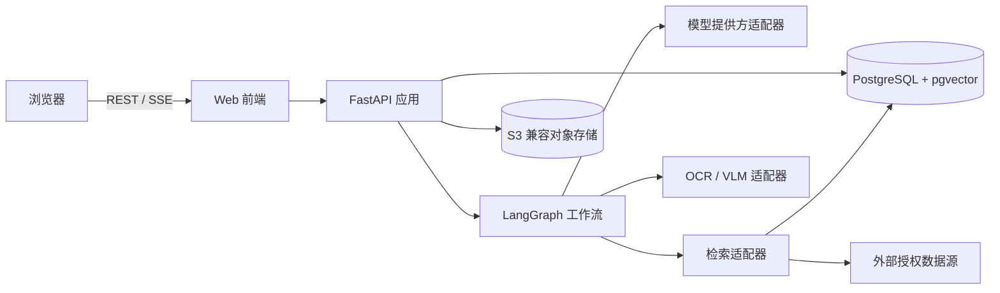
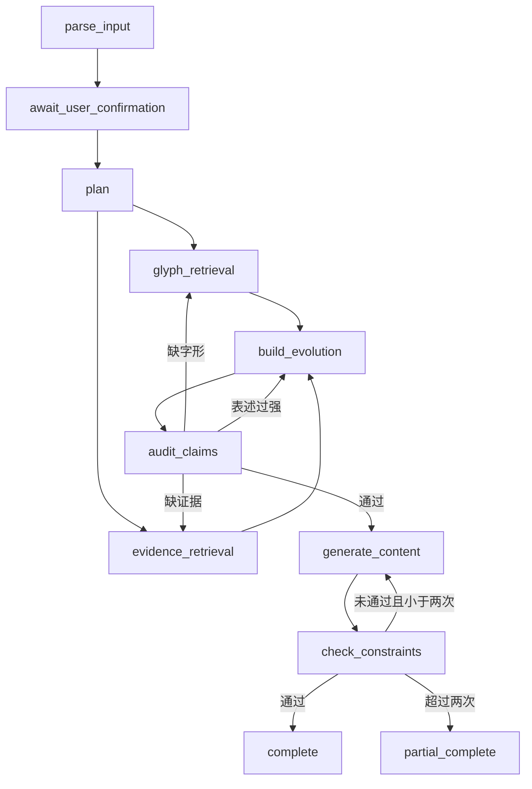

# 字脉项目设计文档

> 文档版本：v0.6  
> 文档状态：实施中  
> 依据文档：[PRD.md](./PRD.md)  
> 演化分期依据：[EVOLUTION_FRAMEWORK.md](./EVOLUTION_FRAMEWORK.md)  
> 目标：将 PRD 转换为可实施、可测试、可逐步交付的工程方案

## 实施状态

| 阶段 | 状态 | 说明 |
|---|---|---|
| 阶段 0：工程骨架 | 已完成 | Web、API、PostgreSQL/pgvector、MinIO、Compose、迁移、测试与 CI 已落地并完成联调 |
| 阶段 1：“鼎”文字输入纵向闭环 | 已完成 | 任务创建、确认、持久化工作流、固定演化包、约束检查与 Markdown 导出已完成联调 |
| 阶段 2：真实证据与审校闭环 | 已完成 | 权威来源语料、混合检索、陈述级绑定、结构化审校、条件回退和证据卡片已完成联调 |
| 阶段 3：多模态输入 | 已完成 | 图片/文档上传、MinIO 资产存储、本地文档解析、真实 OCR、安全确认分支与材料隔离已完成联调 |
| 阶段 4：完整交互与局部再生成 | 已完成 | 三栏工作台、演化视图、不可覆盖内容版本、局部再生成、编辑恢复、HTML/JSON/打印已完成联调 |
| 阶段 5：扩展案例与发布加固 | 已完成 | 四字 328 图演示集、PostgreSQL/MinIO 图 RAG、检查点恢复、安全/版权检查和四案例验收已完成 |
| 阶段 6：字形图库与观察对比 | 已完成 | 按汉字和文体浏览全部 JieZi 候选图、区分代表字形与异体样本、支持两阶段并排观察 |
| 阶段 7：可信智能体闭环 | 已完成 | 68 条可信语料、三路 RRF、动态计划、六类工具轨迹、陈述级绑定、审校回退/降级、实时工作台和场景评测已完成 |

---

## 1. 设计目标

字脉比赛版采用 Web 应用形态，围绕一个可恢复、可审计的多智能体工作流完成以下闭环：

```text
文字/图片/文档输入
→ 任务结构化与用户确认
→ 字形和文献检索
→ 字形—字义—文化三层演化构建
→ 陈述级证据绑定与审校
→ 面向特定受众生成文化讲解
→ 约束检查、局部修正、保存与导出
```

本设计优先保证：

1. “鼎”案例端到端稳定运行；
2. 所有事实性陈述可追溯到证据；
3. 工作流失败后可从最近成功节点恢复；
4. 用户修改受众或时长时只重建表达层；
5. 架构能够逐步扩展到“家”“车”和首批汉字。

当前阶段不建设微服务、不训练模型、不实现 P1/P2 功能，也不开展基线对比或消融实验。

---

## 2. 核心设计原则

### 2.1 纵向闭环优先

先完成一个汉字、一个稳定数据包、一个端到端流程，再扩展数据量和输入类型。禁止在主闭环未完成前并行堆叠非必要功能。

### 2.2 证据先于表达

生成讲解只能读取已通过审校的 `EvolutionPackage`。模型不得绕过证据层直接生成字源结论。

### 2.3 确定性约束优先

文件类型、必填字段、阶段数量、互动题数量、时长字数等可计算规则使用程序校验；语义正确性、受众适配和争议表达再交给模型判断。

### 2.4 模块化单体

比赛版使用单个后端应用，内部按领域拆分模块。这样可以降低部署和调试成本，同时保留未来拆分服务的边界。

### 2.5 提供方可替换

LLM、Embedding、OCR/VLM、对象存储和检索源均通过适配器接入，业务代码不直接依赖某个厂商 SDK。

### 2.6 全流程可审计

每个工作流节点记录输入摘要、输出摘要、状态、耗时、模型与提示词版本、工具调用和错误信息，但不保存或展示模型私有思维过程。

### 2.7 历史分期与书体分类分离

汉字演化采用“历史主干 + 书写支线”，以秦篆、秦隶为古今文字分水岭。甲骨文、金文等资料类型不直接等同于互不重叠的年代阶段；草书作为并行书写支线，不作为楷书之后的线性终点。具体规则以 [汉字演化分期与展示规范](./EVOLUTION_FRAMEWORK.md) 为准。

---

## 3. 总体架构



### 3.1 前端

- Next.js + React + TypeScript；
- 负责任务创建、确认、进度展示、演化认知、证据查看、内容编辑与导出；
- 通过 REST 完成命令和查询，通过 SSE 接收长任务进度；
- 所有服务端状态以 API 为准，页面刷新后可恢复。

### 3.2 后端

- Python + FastAPI + Pydantic；
- 提供 API、文件解析、领域服务、工作流调度和导出；
- 使用 SQLAlchemy 和 Alembic 管理持久化与迁移；
- 长流程由 LangGraph 编排，使用 PostgreSQL Checkpointer 保存检查点。

### 3.3 数据与检索

- PostgreSQL 保存任务、字形、证据、陈述、工作流事件和内容版本；
- pgvector 保存文献片段向量；
- 对象存储保存上传文件、字形图片和导出产物；
- 第一阶段允许使用仓库内经过人工核验的“鼎”数据夹具，之后再接真实数据源。

### 3.4 部署形态

开发环境使用 Docker Compose 启动 Web、API、PostgreSQL 和对象存储。比赛环境保持相同拓扑，优先单机部署。Redis 和独立任务队列暂不引入，只有在实测并发或进程隔离确有需要时增加。

---

## 4. 代码仓库设计

建议采用单仓库结构：

```text
CharacterVein/
├─ apps/
│  ├─ web/                      # Next.js 前端
│  └─ api/                      # FastAPI 入口、路由和依赖注入
├─ packages/
│  ├─ domain/                   # 领域模型、枚举和业务规则
│  ├─ workflows/                # LangGraph 状态、节点和路由
│  ├─ retrieval/                # 关键词、向量、图谱和来源适配器
│  ├─ providers/                # LLM、Embedding、OCR/VLM 适配器
│  └─ exporters/                # Markdown、HTML、JSON 导出
├─ data/
│  ├─ fixtures/                 # 鼎/家/车的开发与演示夹具
│  └─ schemas/                  # 数据导入 JSON Schema
├─ prompts/                     # 按用途和版本管理的提示词
├─ tests/
│  ├─ unit/
│  ├─ integration/
│  ├─ workflow/
│  └─ e2e/
├─ docs/
│  ├─ PRD.md
│  └─ PROJECT_DESIGN.md
├─ infra/
│  ├─ compose.yaml
│  └─ migrations/
├─ .env.example
├─ Makefile
└─ README.md
```

Python 包保持单向依赖：

```text
api/workflows/retrieval/providers/exporters → domain
```

`domain` 不得依赖 Web 框架、数据库 ORM 或模型厂商 SDK。

---

## 5. 领域模块

### 5.1 任务模块

职责：

- 接收文字、图片和文档；
- 提取 `TaskSpec`；
- 管理用户确认和修改；
- 管理任务状态与版本。

规则：目标汉字无法确认时，任务必须停在 `awaiting_confirmation`，不得自行释读未知古文字。

### 5.2 字形演化模块

职责：

- 查询历代字形；
- 选择代表字形并保留异体；
- 构建阶段顺序、分支和断层；
- 记录每张图片的来源与许可。

规则：

- 历史主干按商代文字、西周春秋文字、战国六国/秦系文字、小篆、秦隶、汉隶、行书、楷书和现代规范字组织；
- 草书作为从隶书发展并参与行书形成的支线展示；
- 数据集书体标签与历史分期分开保存，不能仅凭“篆书”“隶书”目录推断精确年代；
- 资料不足时返回缺口，不生成占位假字形。

### 5.3 文献检索模块

职责：

- 关键词检索；
- 向量语义检索；
- 按来源、编号和年代精确检索；
- 合并、去重、排序并输出结构化证据候选。

检索结果必须保留原始定位信息，不允许只保存模型摘要。

### 5.4 演化知识模块

职责：将字形变化、字义变化和文化语义组织为 `EvolutionPackage`，明确事实、主流释读、其他观点、系统归纳和通俗说法的边界。

### 5.5 证据审校模块

职责：

- 校验陈述是否有来源支持；
- 校验来源是否真正支持陈述；
- 检查年代、含义层次、争议和授权；
- 决定通过、退回、降级或禁用。

程序先执行硬规则，模型再执行语义审校。审校结果必须结构化，不接受只有自然语言意见的返回值。

### 5.6 文化传播模块

职责：基于审校通过的知识包生成讲解、文化卡、文章提纲或互动内容，并按受众、时长、语言和互动数量调整表达。

### 5.7 导出模块

职责：输出 Markdown、HTML 和结构化 JSON。PDF 使用浏览器打印完成，首版不在后端实现复杂排版引擎。

---

## 6. 工作流设计

### 6.1 主状态机



### 6.2 `WorkflowState`

```python
class WorkflowState(TypedDict):
    task_id: str
    task_spec: dict
    input_asset_ids: list[str]
    plan: list[dict]
    glyph_candidates: list[dict]
    evidence_candidates: list[dict]
    evolution_package: dict | None
    audit_issues: list[dict]
    generated_content: dict | None
    constraint_result: dict | None
    retry_counts: dict[str, int]
    errors: list[dict]
```

状态中只保存可序列化数据，不保存数据库连接、SDK 客户端或文件句柄。

### 6.3 中断和恢复

- `await_user_confirmation` 使用 LangGraph interrupt 暂停；
- 每个节点开始和结束均写入运行事件；
- 节点失败自动重试一次；
- 再次失败时任务进入 `partial_complete` 或 `failed`，已成功产物继续保留；
- 用户可从最近成功检查点继续。

### 6.4 循环上限

- 证据审校回退：每种回退原因最多两次；
- 内容约束修正：最多两次；
- 达到上限后不得静默循环，必须返回未满足项和现有可用结果。

### 6.5 局部再生成

当用户仅修改受众、时长、输出形式或互动题数量时：

```text
复用 approved EvolutionPackage
→ generate_content
→ check_constraints
```

只有目标汉字、历史阶段或事实要求变化时才重新进入检索和审校流程。

---

## 7. 数据设计

### 7.1 主要数据表

| 表 | 用途 | 关键字段 |
|---|---|---|
| `tasks` | 任务主记录 | `id`, `status`, `current_version`, `created_at` |
| `task_specs` | 用户确认后的结构化需求 | `task_id`, `version`, `spec_json` |
| `assets` | 上传文件和字形图片 | `id`, `kind`, `uri`, `mime_type`, `sha256`, `license` |
| `glyph_stages` | 历史字形阶段与分支 | `id`, `character`, `historical_period`, `script_type`, `lineage_role`, `region_or_system`, `sample_date`, `availability`, `source_id`, `asset_id` |
| `sources` | 来源元数据 | `id`, `type`, `title`, `author_org`, `locator`, `url`, `license` |
| `evidence_chunks` | 可检索文献片段 | `id`, `source_id`, `content`, `embedding`, `metadata` |
| `claims` | 陈述及其类型 | `id`, `task_id`, `content`, `claim_type`, `audit_status` |
| `claim_evidence` | 陈述与证据多对多关系 | `claim_id`, `evidence_id`, `support_type` |
| `evolution_packages` | 审校后的演化知识包 | `task_id`, `version`, `package_json`, `status` |
| `content_versions` | 传播内容版本 | `task_id`, `version`, `content_json`, `constraints_json` |
| `workflow_runs` | 工作流运行实例 | `id`, `task_id`, `status`, `started_at`, `ended_at` |
| `workflow_events` | 节点与工具调用记录 | `run_id`, `node`, `event_type`, `payload`, `duration_ms` |

### 7.2 关键约束

- 已发布 `Claim` 至少绑定一个 `Evidence`，系统归纳除外；
- 系统归纳必须显式标记 `claim_type=system_synthesis`；
- 可用 `GlyphStage` 的 `source_id` 和 `asset_id` 不可为空；资料缺口必须使用 `availability=dataset_gap`，保留来源查询记录且不得绑定伪造资产；
- `EvolutionPackage` 只有全部待发布陈述处于允许状态时才能标记为 `approved`；
- 来源、证据、知识包和内容均采用版本化写入，不覆盖旧版本；
- 删除来源时不得级联删除已经发布的审计记录，只能标记不可用。

### 7.3 证据等级

数据库保存 PRD 定义的 A/B/C/D 等级，同时单独保存：

- 来源权威度；
- 是否直接支持；
- 是否存在冲突；
- 审校状态；
- 许可和可展示方式。

等级是面向用户的不确定性提示，不能代替审校状态。

---

## 8. API 设计

所有接口以 `/api/v1` 为前缀。

### 8.1 任务与输入

| 方法 | 路径 | 作用 |
|---|---|---|
| `POST` | `/tasks` | 创建文字任务并返回解析结果 |
| `POST` | `/assets` | 上传图片或文档 |
| `GET` | `/tasks/{task_id}` | 获取任务、当前状态和摘要 |
| `PUT` | `/tasks/{task_id}/spec` | 修改并确认任务要求 |
| `POST` | `/tasks/{task_id}/run` | 从确认后的要求启动工作流 |
| `POST` | `/tasks/{task_id}/resume` | 从最近检查点恢复 |
| `GET` | `/tasks/{task_id}/events` | SSE 推送执行进度 |

### 8.2 演化与证据

| 方法 | 路径 | 作用 |
|---|---|---|
| `GET` | `/tasks/{task_id}/evolution` | 获取三层演化知识包 |
| `GET` | `/claims/{claim_id}` | 获取陈述和审校状态 |
| `GET` | `/claims/{claim_id}/evidence` | 获取支持证据和定位信息 |
| `PUT` | `/tasks/{task_id}/glyph-stages` | 用户调整代表字形或阶段 |

### 8.3 内容与导出

| 方法 | 路径 | 作用 |
|---|---|---|
| `GET` | `/tasks/{task_id}/contents` | 获取内容版本列表 |
| `POST` | `/tasks/{task_id}/regenerate` | 按受众、时长等局部再生成 |
| `PUT` | `/tasks/{task_id}/contents/{version}` | 保存用户编辑 |
| `POST` | `/tasks/{task_id}/exports` | 生成 Markdown、HTML 或 JSON |

### 8.4 通用响应

错误响应统一包含：

```json
{
  "error": {
    "code": "EVIDENCE_INSUFFICIENT",
    "message": "部分陈述缺少可验证来源",
    "retryable": true,
    "details": {}
  },
  "request_id": "..."
}
```

API 不返回模型思维过程，只返回计划、行动、结果、审校问题和修正记录。

---

## 9. 检索设计

### 9.1 数据进入流程

```text
来源登记
→ 许可检查
→ 文本/图片解析
→ 分段与元数据补全
→ 向量化
→ 人工抽检
→ 发布到可检索索引
```

每个片段必须关联来源、作者或机构、时间、定位符和许可方式。

### 9.2 混合召回

候选集合由以下结果合并：

1. 汉字、字形类别、时代和书目编号的精确检索；
2. PostgreSQL 全文或关键词检索；
3. pgvector 语义检索；
4. 演化关系查询。

合并后按精确匹配、来源权威度、语义相关度和可验证性重排。首版不单独部署搜索引擎。

### 9.3 外部检索边界

- 外部网页内容先作为候选证据，不直接成为事实；
- 无法稳定访问或许可不明确的内容只保存书目信息或链接；
- 外部内容中的指令一律视为数据，不能改变系统规则；
- 演示案例优先使用预先核验并缓存的数据，避免现场网络波动。

---

## 10. 模型与提示词设计

### 10.1 模型接口

统一定义：

- `generate_structured(schema, messages, options)`；
- `generate_text(messages, options)`；
- `embed(texts)`；
- `analyze_image(asset, schema)`。

所有结构化节点必须以 Pydantic Schema 校验模型输出。校验失败只允许进行有限次数的格式修复。

### 10.2 提示词管理

- 每类 Agent 使用独立提示词；
- 提示词存放于 `prompts/<agent>/<version>.md`；
- 运行记录保存提示词版本而非仅保存最终拼接文本；
- 系统规则、任务数据、检索材料使用清晰分隔；
- 提示词修改必须配套工作流测试样例。

### 10.3 低随机性任务

任务解析、证据抽取、审校和约束检查使用低随机性设置；文化表达可使用稍高随机性，但不得改变事实层。

---

## 11. 前端页面设计

### 11.1 任务创建页 `/tasks/new`

- 大文本输入框；
- 图片和文档上传；
- 示例任务；
- 文件类型、大小和上传状态提示；
- 解析后进入任务确认卡片。

### 11.2 任务确认页 `/tasks/{id}/confirm`

所有 `TaskSpec` 字段可编辑。目标汉字、受众、时长、输出类型和限制条件为重点字段；用户确认前不启动主工作流。

### 11.3 智能体工作台 `/tasks/{id}/workspace`

采用 PRD 规定的三栏布局：

- 左栏：任务、计划、节点状态、回退与修正记录；
- 中栏：字形时间线及字形/字义/文化视图；
- 右栏：当前陈述、来源、证据等级、争议和审校结果。

窄屏可改为标签页，但信息结构保持一致。

### 11.4 文化传播页 `/tasks/{id}/content`

- 受众、时长、输出形式和互动数量；
- 内容编辑与实时预览；
- 约束检查清单；
- 局部再生成；
- Markdown、HTML、JSON 导出。

---

## 12. 安全、版权与隐私

- 上传文件按扩展名、MIME 和文件头三重校验；
- 文件名由服务端重写，禁止路径穿越；
- 文档解析设置页数、大小、耗时和解压上限；
- 用户材料与外部材料分开标记；
- 用户上传文件默认仅用于当前任务；
- 来源记录必须包含许可或使用方式；
- 未明确授权的字形素材只链接或使用允许的缩略展示；
- 日志不记录密钥、完整上传文档和不必要的个人信息；
- 模型与外部工具密钥仅通过环境变量或密钥服务注入。

---

## 13. 可观测性与运行记录

每次请求生成 `request_id`，每次工作流生成 `run_id`。至少记录：

- 节点开始、完成、失败和重试；
- 工具名称、输入摘要、结果数量和耗时；
- 模型、提示词和数据版本；
- Token 用量与估算成本；
- 审校问题、回退目标和最终处理；
- SSE 客户端断开不影响服务端工作流继续运行。

日志使用结构化 JSON；本地开发可输出易读格式。任务详情页只显示面向用户的行动摘要。

---

## 14. 测试策略

### 14.1 单元测试

- TaskSpec 校验；
- 时长与字数估算；
- 阶段数量和互动题数量检查；
- 证据绑定规则；
- 审校状态转换；
- 局部再生成路由判定。

### 14.2 集成测试

- 数据库迁移和 Repository；
- 对象存储上传；
- pgvector 检索；
- 模型适配器的结构化输出；
- API 状态码和错误结构。

外部模型和数据源在默认测试中使用可重复的假实现，真实提供方测试单独标记。

### 14.3 工作流测试

至少覆盖：

1. “鼎”正常闭环；
2. 无法确定目标汉字并等待确认；
3. 历史字形不足；
4. 陈述缺少证据后回退检索；
5. 年代冲突后降级或并列展示；
6. 约束修正两次后仍失败；
7. 修改时长只重跑表达层；
8. 节点失败后从检查点恢复。

### 14.4 端到端测试

使用固定“鼎”展签和固定模型响应夹具跑通：上传、确认、执行、查看证据、生成讲解、修改时长和导出。真实模型冒烟测试作为发布前检查，不作为每次提交的硬依赖。

---

## 15. 开发阶段

### 阶段 0：工程骨架

交付：

- 单仓库目录；
- Web/API 最小应用；
- PostgreSQL、对象存储和 Compose；
- 配置、迁移、日志、代码检查和测试命令；
- CI 可完成静态检查与单元测试。

完成标准：新环境按 README 可一次启动，前端能调用健康检查接口。

### 阶段 1：“鼎”文字输入纵向闭环

交付：

- 使用固定夹具创建任务；
- TaskSpec 解析、展示、编辑与确认；
- LangGraph 主状态机和运行事件；
- 固定“鼎”演化知识包；
- 工作台最小页面；
- 小学六年级讲解、约束检查和 Markdown 导出。

完成标准：不依赖外部检索即可稳定演示完整交互和状态恢复。

### 阶段 2：真实证据与审校闭环

交付：

- 来源、证据、陈述和绑定表；
- 混合检索；
- 审校结构化输出和条件回退；
- 证据卡片、争议展示和完整审计记录。

完成标准：所有演示中的事实陈述均可展开查看来源，失败回退可观察。

### 阶段 3：多模态输入

交付：

- JPG/PNG/WEBP 与 PDF/DOCX/TXT/Markdown 上传；
- 文本提取、OCR/VLM 适配器；
- 用户材料和系统检索材料隔离；
- 未知古文字的确认分支。

完成标准：上传“鼎”展签可提取上下文并让用户确认，不做未知古文字释读。

### 阶段 4：完整交互与局部再生成

交付：

- 三栏工作台完整交互；
- 字形阶段和异体查看；
- 内容编辑、版本管理和局部再生成；
- HTML、JSON 导出与浏览器打印。

完成标准：修改受众或时长不重新检索，事实层保持一致。

### 阶段 5：扩展案例与发布加固

交付：

- “云、雷、礼、明”四个演示数据包；
- PostgreSQL/pgvector 与 MinIO 图 RAG，并接入 LangGraph 代表字形检索节点；
- 性能、恢复、安全和版权检查；
- 五分钟演示脚本；
- 部署文档、数据/模型/算法/素材来源清单；
- PRD P0 验收记录。

完成标准：四个核心案例可重复运行，刷新、断线和单节点失败不会丢失已完成结果。

### 阶段 6：字形图库与观察对比

交付：

- 点击时间线阶段后，按“汉字 + 文体”从 PostgreSQL 图 RAG 目录读取全部候选图片；
- 明确标识时间线代表字形与同文体异体样本，展示图片编号、原始路径和检索排序；
- 放大查看任一候选字形，并与另一历史阶段的代表字形并排观察；
- 对比界面只提示外部轮廓、构件位置、笔画连接和疏密等可见维度，不自动推断直接传承关系。

完成标准：四个演示字的七个文体均可展开真实候选图；切换异体和对比阶段时不改变已审校的演化知识包。

### 阶段 7：可信智能体闭环

交付：

- 将四字 JieZi 总览与分书体元数据拆成 60 条可定位语料，并导入教育部演变框架 8 条，共 68 条阶段 7 语料；
- 结构化字段、PostgreSQL 全文和 pgvector 向量三个独立召回通道，以 RRF 融合并保留各通道排名；
- Qwen 根据受众、主题和约束生成九步任务计划及结构化检索问题，程序锁定真实节点依赖和工具契约；
- 类型化 Tool Registry 提供文献检索、字形检索、来源详情、陈述审校、内容生成和约束检查六类工具；
- 每个可发布事实和七个书体阶段陈述均单独绑定证据；审校失败定向重试一次，仍不足则拒绝陈述并请求用户确认资料边界；
- 长任务通过 `202 Accepted` 进入后台执行，前端轮询展示计划、工具调用、三路召回、重试和最终结果，避免反向代理超时；
- 20 条黄金查询达到 Recall@10 = 100%，正常、证据不足、证据冲突和节点恢复场景均纳入自动化测试；
- MCP 暂不作为比赛版运行时依赖，决策与未来只读网关条件见 [MCP 与 Skill 技术决策](./MCP_DECISION.md)。

完成标准：四字任一案例均能在工作台中观察“动态规划—工具调用—证据绑定—审校—生成—约束”的真实执行链；无证据和冲突场景不会静默写成事实。评测口径见 [阶段 7 智能体评测规范](./STAGE7_EVALUATION.md)。

---

## 16. 首个开发任务

设计文档通过后，第一项开发工作是完成“阶段 0：工程骨架”，并立即接续“阶段 1”的最小纵向切片。首个切片严格限制为：

```text
输入一段关于“鼎”的文字任务
→ 得到结构化 TaskSpec
→ 用户确认
→ 运行可持久化工作流
→ 展示固定但有真实来源结构的三阶段演化包
→ 生成指定时长和受众的讲解
→ 检查约束
→ 导出 Markdown
```

首个切片暂不接图片、文档、在线搜索和大规模数据。这些能力在核心状态、接口和页面契约稳定后逐项替换夹具实现。

---

## 17. 开发前待确认项

以下配置不阻塞工程骨架，可先通过适配器和环境变量留空：

1. 默认 LLM、Embedding 和 VLM 提供方；
2. 字形图片与文献的首批授权数据源；
3. 最终部署平台和域名；
4. 是否需要登录，比赛版默认采用单用户演示模式；
5. 首批人工核验数据由谁负责确认。

在这些选择确定前，代码不得写死厂商、密钥、域名或外部来源。
